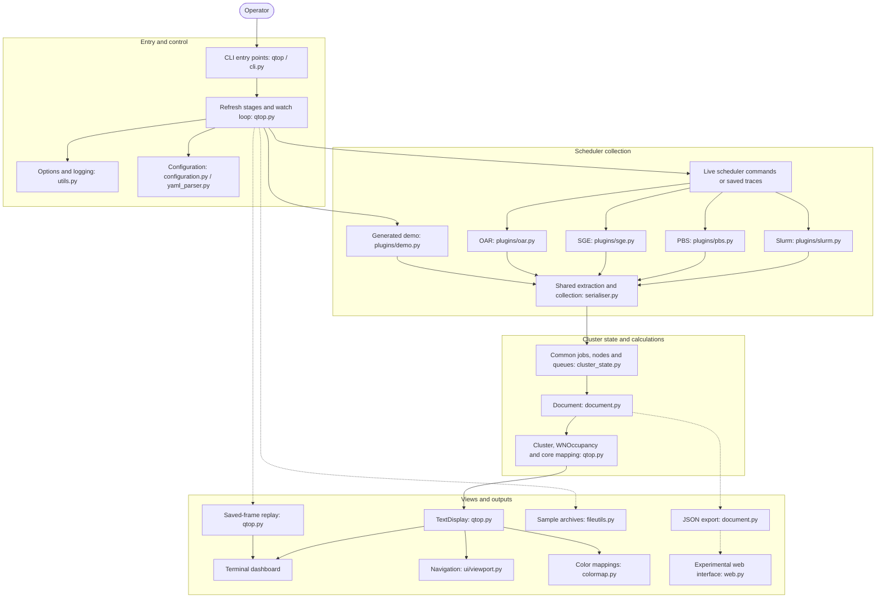

# qtop architecture

qtop collects scheduler output, turns it into a common cluster state, and
presents jobs, queues, nodes and core occupancy in a terminal. This overview
adapts the GitDiagram description proposed in
[issue #571](https://github.com/qtop/qtop/issues/571) to the current source.
The diagram is stored as Mermaid so it can be reviewed and updated with the
code, and rendered directly on GitHub.

## Runtime overview

Solid arrows show control or data flow; dotted arrows show optional outputs.
Several stages live in `qtop_py/qtop.py`; the groups describe responsibilities
within the existing program.

## Following a snapshot through the code

1. The CLI enters `cli_main()` and `main()` in
   [qtop.py](../qtop_py/qtop.py). The runtime loads configuration, selects a
   registered backend, and either executes its configured commands or reads
   files supplied with `-s`. The demo backend generates fictional data.
   The loop calls `collect_snapshot()`, `export_snapshot()`, `prepare_refresh()`
   and `render_refresh()`; keyboard handling remains outside those stages.
   [configuration.py](../qtop_py/configuration.py) owns file precedence,
   normalization, CLI overrides and validation. The runtime passes configuration,
   options and the selected backend explicitly to collection helpers.
2. Each backend implements `get_jobs_info()`, `get_queues_info()` and
   `get_worker_nodes()`. `GenericBatchSystem.get_cluster_state()` in
   [serialiser.py](../qtop_py/serialiser.py) combines their results through
   [build_cluster_state()](../qtop_py/cluster_state.py).
   Backend class hooks also define command adjustments, optional trace aliases,
   detection priority, queue blocking and scheduler-specific display notes.
   The core dispatches these policies without testing scheduler names.
3. `Document.from_cluster_state()` in [document.py](../qtop_py/document.py)
   owns the normalized snapshot and exposes cached legacy rendering fields.
   Exports read that authoritative state; the five-field constructor remains
   available for old trace adapters. `Cluster`, `WNFilter` and `WNOccupancy` calculate node
   layout, filtering, user accounting and per-core occupancy. `TextDisplay`
   renders the three terminal sections, using viewport navigation and color
   mappings.
4. `-E` exports the snapshot as JSON. `-L` creates a support sample archive.
   `-R` replays saved rendered frames. The experimental `-B` web interface
   serves exported JSON and requires `-e`; these are distinct output paths.

`RunResources` owns redirected output, temporary frames, web shutdown and replay
workspaces. It finalizes each capture before the next refresh can replace its
traces, restores the launch directory, and reports capture paths at exit.
Menu input restores terminal settings even when interrupted.

## Source map

| Responsibility | Source |
| --- | --- |
| Launchers and installed entry point | [qtop](../qtop), [cli.py](../qtop_py/cli.py), [pyproject.toml](../pyproject.toml) |
| Runtime orchestration, calculations and terminal rendering | [qtop.py](../qtop_py/qtop.py) |
| Command-line options and logging | [utils.py](../qtop_py/utils.py) |
| Configuration loading, preparation and parsing | [configuration.py](../qtop_py/configuration.py), [qtopconf.yaml](../qtopconf.yaml), [yaml_parser.py](../qtop_py/yaml_parser.py) |
| Scheduler backends | [Slurm](../qtop_py/plugins/slurm.py), [PBS](../qtop_py/plugins/pbs.py), [SGE](../qtop_py/plugins/sge.py), [OAR](../qtop_py/plugins/oar.py), [demo](../qtop_py/plugins/demo.py) |
| Shared extraction and backend interface | [serialiser.py](../qtop_py/serialiser.py) |
| Canonical document and legacy adapter | [document.py](../qtop_py/document.py) |
| Run resource ownership and frame/archive finalization | [runtime.py](../qtop_py/runtime.py) |
| Common snapshot construction, validation and totals | [cluster_state.py](../qtop_py/cluster_state.py) |
| Navigation and color definitions | [controls.py](../qtop_py/ui/controls.py), [viewport.py](../qtop_py/ui/viewport.py), [colormap.py](../qtop_py/colormap.py) |
| Capture archives and temporary files | [fileutils.py](../qtop_py/fileutils.py) |
| Experimental HTTP output | [web.py](../qtop_py/web.py), [web/index.html](../qtop_py/web/index.html) |

## Keeping the overview current

When collection, state or output responsibilities change, update the Mermaid
source and source map in this file. Check new backend coverage through the
[shared sample gates](ci-sample-gates.md), and consult the
[CI structure](ci-structure.md) for validation entry points. User-facing
commands and display behavior are described in the [qtop guide](documentation.md).
