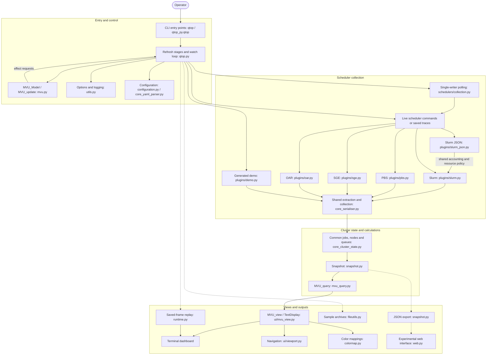

# qtop architecture

qtop collects scheduler output, turns it into a common cluster state, and
presents jobs, queues, nodes and core occupancy in a terminal. This overview
adapts the GitDiagram description proposed in
[issue #571](https://github.com/qtop/qtop/issues/571) to the current source.
The diagram is stored as Mermaid so it can be reviewed and updated with the
code, and rendered directly on GitHub.
The data contract between backends and views, its schema versions and its
logical relations are described in [cluster-state-model.md](cluster-state-model.md).

The keyboard reader in `ui/controls.py` decodes complete terminal keys without
TextIO read-ahead. Account totals render as section 4 independently of section 3.

## Runtime overview

Solid arrows show control or data flow; dotted arrows show optional outputs.
`qtop_py/qtop.py` owns runtime I/O and effect execution. The MVU modules
separate state transitions, snapshot queries and terminal presentation.

## Following a snapshot through the code

1. The CLI enters `cli_main()` and `main()` in
   [qtop.py](../qtop_py/qtop.py). The runtime loads configuration;
   `schedulers/registry.py` selects a registered backend. The collector either
   executes its configured commands or reads
   files supplied with `-s`. The demo backend generates fictional data.
   `schedulers/collector.py` adapts the CLI options and configuration to
   [core_collect.py](../qtop_py/core_collect.py), which builds the command lines,
   runs them concurrently and finds the traces, and owns capture-aware snapshot
   construction. The loop calls `MVU_collect_snapshot()`,
   `MVU_export_snapshot()`,
   `MVU_query()` and `MVU_view()`. The snapshot is complete when built: display
   job states and collection timings are passed to `Snapshot.from_cluster_state()`.
   `MVU_update()` accepts snapshots, the per-frame `terminal` facts (frame time,
   256-colour support, whether stdout is a terminal; captured by
   `ui/terminal.capture_terminal()`) and keyboard messages, returning a new model
   and effect requests. The view reads no clock or environment, so one model
   renders the same text; UI state holds flags such as `show_help`, while the
   runtime chooses the files to show. The runtime executes
   menu input and terminal effects through `ui/effects.py` and
   `ui/terminal.py`; `user_details.py` owns optional account enrichment.
   [configuration.py](../qtop_py/configuration.py) owns file precedence,
   normalization, CLI overrides and validation. The runtime passes configuration,
   options and the selected backend explicitly to collection helpers.
2. Each backend implements `get_jobs_info()`, `get_queues_info()` and
   `get_worker_nodes()`. `GenericBatchSystem.get_cluster_state()` in
   [core_serialiser.py](../qtop_py/core_serialiser.py) combines their results through
   [build_cluster_state()](../qtop_py/core_cluster_state.py).
   Backend class hooks also define command adjustments, optional trace aliases,
   detection priority, queue blocking and scheduler-specific display notes.
   The core dispatches capabilities; scheduler support rules validate and mask extensions.
3. `Snapshot.from_cluster_state()` in [snapshot.py](../qtop_py/snapshot.py)
   owns the normalized snapshot and exposes cached legacy rendering fields.
   Exports read that authoritative state; the five-field constructor remains
   available for old trace adapters. `MVU_query()` builds private view data
   with copied nodes, options and viewport. The render model carries
   `display_overrides`, `user_details` and `transposed_sections`. `Cluster`, `WNFilter` and
   `WNOccupancy` in [mvu_query.py](../qtop_py/mvu_query.py) calculate layout,
   filtering, user accounting and per-core occupancy. `MVU_view()` delegates
   the four terminal sections to [mvu_view.py](../qtop_py/ui/mvu_view.py).
   Both stages receive an explicit model rather than reading runtime globals;
   derived layout does not modify the canonical snapshot.
4. `-E` exports the snapshot as JSON. `-L` creates a support sample archive.
   `-R` replays saved rendered frames. The experimental `-B` web interface
   serves exported JSON and requires `-e`; these are distinct output paths.

`RunResources` owns redirected output, temporary frames, web shutdown and replay
workspaces. It finalizes each capture before the next refresh can replace its
traces, restores the launch directory, and reports capture paths at exit.
Menu input restores terminal settings even when interrupted.

[mvu.py](../qtop_py/mvu.py) uses ordinary Python 3.6-compatible classes and
functions, with no framework dependency. Legacy collection occurs once per
refresh; interval-driven backends use the single-writer poller. The MVU split
adds no scheduler commands. Legacy imports and controller
entry points remain adapters in `qtop.py`; those adapters still support the old
runtime globals, while the new query/view pipeline does not depend on them.

## Source map

| Responsibility | Source |
| --- | --- |
| Launchers and installed entry point | [qtop](../qtop), [qtop.py](../qtop_py/qtop.py), [pyproject.toml](../pyproject.toml) |
| CLI/watch orchestration and helper re-exports | [qtop.py](../qtop_py/qtop.py) |
| Explicit model and update messages | [mvu.py](../qtop_py/mvu.py) |
| Snapshot queries, filtering and occupancy calculations | [mvu_query.py](../qtop_py/mvu_query.py) |
| Watch effects, prompts and menus | [effects.py](../qtop_py/ui/effects.py) |
| Terminal modes, signals, sizing and key waits | [terminal.py](../qtop_py/ui/terminal.py) |
| Optional account names and groups | [user_details.py](../qtop_py/user_details.py) |
| Terminal presentation | [mvu_view.py](../qtop_py/ui/mvu_view.py) |
| Command-line options and logging | [utils.py](../qtop_py/utils.py) |
| Configuration loading, preparation and parsing | [configuration.py](../qtop_py/configuration.py), [qtopconf.yaml](../qtopconf.yaml), [core_yaml_parser.py](../qtop_py/core_yaml_parser.py) |
| Scheduler selection and collection orchestration | [registry.py](../qtop_py/schedulers/registry.py), [collector.py](../qtop_py/schedulers/collector.py) |
| Bounded subprocess execution | [core_process.py](../qtop_py/core_process.py) |
| Scheduler backends and support | [Slurm](../qtop_py/plugins/slurm.py), [PBS](../qtop_py/plugins/pbs.py), [SGE](../qtop_py/plugins/sge.py), [OAR](../qtop_py/plugins/oar.py), [demo](../qtop_py/plugins/demo.py), [support helpers](../qtop_py/schedulers/) |
| Shared extraction and backend interface | [core_serialiser.py](../qtop_py/core_serialiser.py) |
| Shared state/configuration types and backend protocol | [core_state_types.py](../qtop_py/core_state_types.py) |
| Canonical snapshot and legacy adapter | [snapshot.py](../qtop_py/snapshot.py) |
| Replay time and account expression parsing | [input_parsing.py](../qtop_py/input_parsing.py) |
| Run resources, frame/export I/O, replay and extraction workspaces | [runtime.py](../qtop_py/runtime.py) |
| Common snapshot construction, validation and totals | [core_cluster_state.py](../qtop_py/core_cluster_state.py) |
| Navigation and color definitions | [controls.py](../qtop_py/ui/controls.py), [viewport.py](../qtop_py/ui/viewport.py), [colormap.py](../qtop_py/colormap.py) |
| Scheduler input reading for backends (core) | [core_inputs.py](../qtop_py/core_inputs.py) |
| Capture archives, private directories and fallback | [fileutils.py](../qtop_py/fileutils.py) |
| Experimental HTTP output | [web.py](../qtop_py/web.py), [web/index.html](../qtop_py/web/index.html) |

### Retired legacy adapters

The pre-MVU entry points `MVU_legacy_model()`, `colorize()`, `control_qtop()`, the
`Cluster`, `WNOccupancy` and `TextDisplay` wrapper classes, the `Document` alias and the
`choose_sort/filter/highlight` wrappers were removed from `qtop.py` in 0.9.20261119, after a
`DeprecationWarning` since 0.9.20261110. They built their model from module globals (`args`,
`config`, `dynamic_config`, `viewport` and so on). Build an `MVU_Model` and pass it to
`MVU_update`, `MVU_effects`, `MVU_query` and `MVU_view`; use `mvu_query.Cluster`,
`mvu_query.WNOccupancy` and `ui.mvu_view.TextDisplay` with an explicit `MVU_model`, and
`MVU_Model.MVU_colorize`. Tests do the same through `tests/mvu_support.explicit_model()`.
`main()` sets no module globals; `tests/test_runtime.py` fails if a run brings any back.

The CLI re-exports extracted public helpers so existing imports and exception
handlers keep working; these pure re-exports were not part of the retirement.
Menu effects pass the model's colour callback explicitly. Implementation
tests patch the owning module rather than the entry point. No owner imports
`qtop.py`; `RunPaths` lives with `RunResources`, and shared configuration errors
and scheduler exceptions belong to their configuration/error modules.

## Extension boundaries and readiness

### Scheduler core and application

The scheduler core (the top-level `qtop_py/core_*.py` modules, the backends in
`plugins/` and the `schedulers/` helpers except the collector) is kept ready to
become a library. It imports only other core modules, and does not print,
write to stdout or stderr, exit, or read the environment or home directory.
Configuration files, savepath, logging setup, colours, the CLI's messages and the
TUI belong to the application, which passes the core what it needs. For example,
scheduler errors carry the requested name and choices, and the CLI words them.
[test_core_boundary.py](../tests/test_core_boundary.py) enforces this; its
Backends take the shared interface from
[core_api.py](../qtop_py/core_api.py), the library's public surface for them, and
report raw names: `-A` masks the built state once, in the collector. For library
callers, `core_api.collect_state(backend, workdir, options, env=os.environ)` runs a
backend end to end (its commands, or a `BackendOptions(SOURCEDIR=...)` directory)
and returns a validated cluster state, with no CLI, configuration file or TUI.
`KNOWN_VIOLATIONS` is empty: the core reads no environment and no application
constants (the command runner takes `env`, its timeout and a `config_name` for its
messages from the caller).

The [modular compatibility plan][modular-plan] for issue #593 uses an
illustrative layout. Preserve existing module paths and public
interfaces; add modules only when a backend supplies data and a consumer
needs the behavior. No empty schema or extension packages are needed.

`ui/viewport.py` stays in the presentation layer. Its bounds, scrolling and
terminal geometry are independent of scheduler policy and schema records.
MVU copies viewport state explicitly; canonical observations do not contain
it. Future hierarchy or topology views can add view state when implemented,
without moving the current viewport or requiring plugins to import it.

Current implementation and remaining preparation:

- [x] Keep existing `plugins/` paths and backend interfaces. Collection,
  detection, queue policy and display-note hooks are backend-controlled;
  `tests/test_scheduler_policy.py` exercises a custom backend.
- [x] Separate normalized observations from MVU queries and presentation;
  the legacy adapters are retired (0.9.20261119).
- [x] Preserve schema-1/2 validation, replay and anonymization contracts;
  schema 3 beta1 adds opt-in workload parentage without changing old versions.
- [x] Separate growing backend-specific metadata rule sets from the central
  dispatcher in `schedulers/metadata.py`: each backend owns an `ExtensionSpec`
  (`plugins/slurm_extension.py`, inline in `plugins/oar.py`) declared as its
  `extensions`; metadata collects them from the registry on first use (plugins use
  only the standard library); `tests/test_plugin_conformance.py` checks every backend.
- [x] Consolidate repeated backend defaults: each plugin declares its commands,
  signature command, detection priority and state names; the registry finds plugin
  modules (`pkgutil`) and `qtop.backends` entry points, and the sample gate covers
  every registered backend. Still no framework beyond those two mechanisms.
- [ ] Define resource quantities, unknown placement and renderer capabilities
  with the first backend that needs them. Integer `np` and `core_job_map`
  remain the existing CPU-grid contract, not a generic resource model.

Kubernetes namespaces, OpenStack projects and Flux scheduler scopes must keep
native meaning. Do not represent unknown placement as free cores, convert
fractional requests into invented core assignments, or double-count delegated
resources. The [schema guide](cluster-state-model.md#future-extension-contracts)
defines the future semantic boundaries; new identifiers and extensions need
validation, anonymization and replay coverage together.

`plugins/slurm_json.py` now adapts versioned JSON into existing Slurm identity,
accounting, CPU and GPU policies. `schedulers/collection.py` owns single-writer
polling and atomic successful-observation publication; RunResources owns worker
shutdown. The core uses backend-owned interval/fallback hooks, not scheduler-name
branches. Slurm JSON reuses Slurm presentation configuration through
`display_scheduler`. JSON is parsed once per collection; UI snapshots copy the
published canonical state. Malformed refreshes retain the prior observation.
Legacy Slurm summary mode omits allocation-detail collection through the
backend command hook and collects synchronously on each display cycle.
The [Slurm JSON guide](documentation.md#slurm-json-backend) documents supported
schemas, partial-SMT limits and conservative raw-JSON masking omissions.

## Keeping the overview current

When collection, state or output responsibilities change, update the Mermaid
source and source map in this file. Check new backend coverage through the
[shared sample gates](ci-sample-gates.md), and consult the
[CI structure](ci-structure.md) for validation entry points. User-facing
commands and display behavior are described in the [qtop guide](documentation.md).

CollectionSettings is the typed, validated view of live command settings.
The complete Config mapping stays extensible for scheduler-specific keys;
collection functions accept the GenericBatchSystem class interface rather
than an unconstrained backend. Normalize at the boundary, before execution.

[modular-plan]: https://github.com/qtop/qtop/issues/593#issuecomment-6793829851
