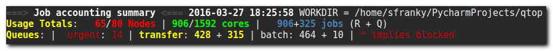
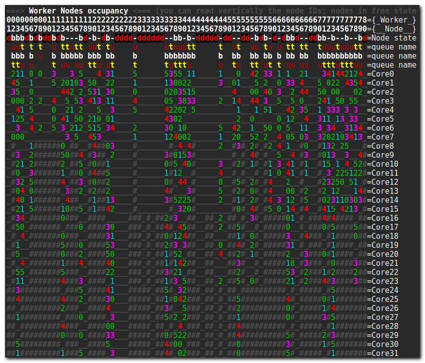
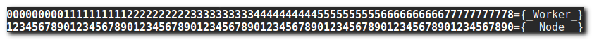
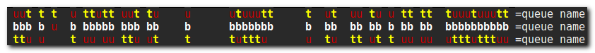
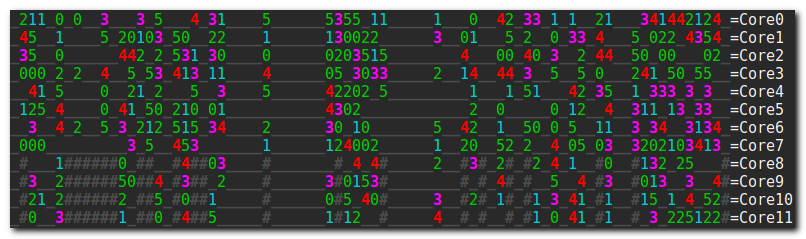
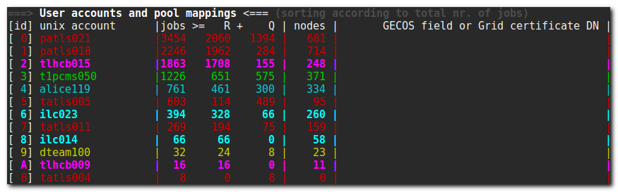

qtop guide
==========

-  [Introduction](#introduction)
-  [Architecture and source map](architecture.md)
-  [Quickstart](#quickstart)
-  [Demo case study](#demo-case-study)
-  [Bundled scheduler case studies](#bundled-scheduler-case-studies)
-  [Output walkthrough](#output-walkthrough)
-  [Watchmode](#watch-mode)
-  [Instant Replay](#instant-replay)
-  [Customisation](#customisation)
-  [Capture and JSON export](#capture-and-json-export)
-  [Command-line arguments](#command-line-arguments)
-  [Usage tips](#usage-tips)

Introduction
------------

### Background

qtop's Python version is based on the original qtop bash script written
by @fgeorgatos long ago. The main reason for rewriting it from scratch
in Python was the drive to add some much-needed functionality, which was
getting harder and harder to do in bash. The Python version is much more
extensible and can support more Local Resource Management Systems, such
as Oracle/Sun Grid Engine (SGE/GE), LSF, LoadLeveler, OAR, SLURM etc.
It's also less buggy, with most of the bugs of the old version eradicated
...and new ones
introduced ;-)

### Goals

qtop summarizes, textually and visually, the state of a Resource
Management System, along with relevant cluster information. It gathers
information from the Resource Management System and organises it in a
compact yet illustrative format for easy access. Expandability and
configurability were deemed very important and were taken into account
from the very early stages of designing qtop. What's more, it is
intended that the information gathered by qtop can be reused by other
developers or system administrators, either for other purposes or in
different visualisation formats/media. For this reason, qtop exports the
gathered information to a convenient JSON format. The project also goes
to great lengths to keep qtop dependency-free. That means, you don't
have to download or install anything extra; qtop works out of the box!

Quickstart
----------

The absolute simplest way to get qtop to display *anything* is by
invoking it in demo mode:

```sh
./qtop -b demo
```

When used, the ``-b`` switch must always be followed by one of the
supported batch systems (pbs, sge, oar, slurm, demo).

That should create and destroy fictional jobs in fictional machines from
fictional users, and display all that in a colorful but not yet very
helpful way. The data produced will probably be more than a screenful,
so most of it is going to scroll up and away. If you want to start
making any sense of it, you're better off trying this:

```sh
./qtop -b demo -w
```

which keeps updating the screen with freshly made-up data, and also
keeps you at the beginning of it. This is called the [watch mode](#watch-mode). You'll notice that this time it's the end that
you cannot see, so now would be a good time to introduce
[keybindings](#keyboard-shortcuts) to move around.

Most of what you can see on screen is customisable **on-the-fly** by
editing a [configuration file](#customisation). Some modifications
can also be accomplished by using the aforementioned
[keybindings](#keyboard-shortcuts).

Demo case study
---------------

Use demo mode when you want to learn qtop's display without access to a
live PBS, SGE, OAR, or Slurm cluster. The demo backend generates fictional
worker nodes, jobs, queues, and users, so it is useful for checking the
layout and keyboard workflow before pointing qtop at production
scheduler data.

Start with a one-shot render:

```sh
./qtop -b demo
```

Then try the same input with common display switches:

```sh
./qtop -b demo -FT
```

This combines two useful view changes:

-  ``-F`` shows full worker node names instead of compact numbers.
-  ``-T`` transposes the worker-node matrix so nodes are rows instead
   of columns.

For a large demo view, let the output overflow horizontally and inspect
it with ``less``:

```sh
./qtop -b demo -l | less -RS
```

For an interactive session, use watch mode. The optional value after
``-w`` is the refresh interval in seconds:

```sh
./qtop -b demo -w 10
```

While in watch mode, the movement keys from [Keyboard shortcuts](#keyboard-shortcuts) let you move through the matrix,
transpose it, switch node ID display, apply filters, or quit.

Bundled scheduler case studies
------------------------------

The ``qtop_py/contrib`` directory contains captured scheduler snapshots
for quick checks without access to a live cluster:

```sh
./qtop -s qtop_py/contrib -c ON -Fadvv -b sge
./qtop -s qtop_py/contrib -c ON -Frdvvv -b oar
./qtop -s qtop_py/contrib -c ON -raF -b pbs
```

Use ``-s`` for saved scheduler files and ``-b`` for the matching parser.

Output walkthrough
------------------

### The three qtop sections

The information that qtop conveys when run can be divided into three
sections:

#### Accounting Summary

-  number of nodes (Total:available (online):Free (non-exclusive))
-  number of cores (available/total)
-  number of jobs (running/queued)
-  queue names, along with running/queued jobs info for every queue



*Accounting Summary*

If a queue is denoted as blocked in the Resource Management System, it
will be marked with an asterisk.

#### Worker Nodes Occupancy

The heart of qtop lies in this sector, which is essentially a matrix
(potentially wrapped at the end of the terminal, resulting in a series
of matrices), modular in nature. There are two ways to visualise the
matrix, one where the columns are worker nodes and the rows are the node
characteristics, and another where the matrix is transposed, i.e. the
**rows** are the worker nodes and the columns are their characteristics.
We'll be referring to the first form in our examples, which was also the
original form used in old qtop.

The default characteristics are the node state, the names of the queues
involved and the job per core allocation table.

This, however, is customisable: as long as there are characteristics of
interest existing in the Resource Management System input file, the User
should be able to describe the characteristic inside the config file and
have a new vector spawn inside the matrix.

One dimension is used to array the worker nodes and another to expand
the worker node characteristics (individual cores, node state,
associated queues etc). 

The default elements displayed are:

Worker node ID (virtual or real node name)



*worker nodes ID*

The options here are either the real full name of the worker nodes, or a
numbering scheme. If the worker node numbering is atypical, e.g. from
``pc23`` there's a jump to ``pc-b-145``, the standard representation
scheme will represent such gaps with non-existent worker nodes, which
might not always be desirable. Hence, a remapping mechanism will be put
in place, giving consistent numbering starting from zero, to all nodes
belonging to the cluster.

Node state


*Node state*

The node state is denoted with the first letter of the state. For PBS,
for example:

-  **j**: job-exclusive
-  **b**: busy
-  **o**: offline
-  **d**: down

The symbol "**-**" is used when the node is free.

Queue names



*Queue name*

The queue names sector shows the initials of the queue names loaded with
jobs running on the specific worker node. The full names of the queues
show up earlier in the Accounting Summary, color-coded in the same way.
So if you have queues all starting with the same letter, e.g. grid3000M,
grid2000M, grid5000M, the colouring will help you see which is which.

Job allocation table



*Cores*

The jobs are displayed via their owner, who is given a single-character
ID. The mapping is shown on the [User account information](#user-account-information) section. An underscore '\_'
denotes a free core. A hash symbol '#' means that the core in this
position does not exist on this worker node. If, for example, a
hundred-node cluster consists of 96 worker nodes of 32 cores and 4
worker nodes of 16 cores, the last 16 core position in those 4 worker
nodes will be substituted with the hash symbol.

#### User account information



*user accounts*

-  ``id`` is a symbol denoting a unique unix account
-  the jobs of every user, with distinct mention for the running jobs
   vs. the total number of jobs (including the finished ones)
-  the name of the unix account
-  optional GECOS details (``-G``) and primary Unix group (``--show-groups``)

Rows follow the displayed ``id`` column: the configured ``possible_ids``
order normally, or alphabetical ID order with ``fill_with_user_firstletter``.
Rows sharing an ID use ascending username order, regardless of job counts.
Overflow rows marked ``*`` appear last, also ordered by username. Sorting the
table does not change user IDs or the color precedence of shared IDs.

``-4`` adds a totals row. ``-G`` retrieves account details with the
configured ``getent passwd`` command; the default cache is
``$HOME/.local/qtop/getent_passwd.txt`` when real-time lookup is disabled.
``--show-groups`` resolves each user's primary Unix group through the local
account database. Neither option requires a Grid pool-mapping command.

Watch mode
----------

The watch mode is a step-up from the original implementation, where the
user was able to run qtop with ``watch -d`` prepended, so as to be able
to watch an almost real-time evolution of the system monitored. Alas,
there was no way to retain qtop's coloring information with watch (not
in older versions of watch, anyway). An in-house implementation of watch
was hence inspired, and along with that came new features that original
watch doesn't provide, giving interactivity to the user, in an
ncurses-like fashion.

Watch mode supports:

-  navigation through a big matrix, as if more/less were used (more or
   less ;) with vim-like commands
-  matrix transposition (switch between rows<->columns)
-  node ID type switch (from proper full node name to bare numbering)
-  coloring code switch (user id coloring/queue coloring)
-  real-time filtering of nodes according to name substring or
   RegEx/node state/node number

### Keyboard shortcuts

#### Navigation

| shortcut | function |
| --- | --- |
| j / Space | go down one screen |
| k / Backspace | go up one screen |
| h / l | go left / right one screen |
| g / K | go to the top of the matrix |
| G / J | go to the bottom of the matrix |
| 0 / $ | go to the left / right edge |
| R | reset the viewport |

#### View and session controls

| shortcut | function |
| --- | --- |
| f | apply filtering |
| F | switch full names / numbered node labels |
| H | highlight users or queues |
| m | switch core coloring by user / queue |
| Q | expand / collapse the queueing summary |
| r | cycle all / real / used core lines |
| s | apply sorting |
| t | transpose the matrix |
| ? | toggle interactive help |
| q | quit qtop |

Instant Replay
--------------

The output of qtop is kept in ``/tmp/qtop_results_$USER`` (configurable
in ``qtopconf.yaml``), so that users can "replay" the state of their
system from a particular point in time. By default, the output is kept
for the last 24 hours, but this is also configurable in
``qtopconf.yaml``.

To replay from a specific point in time, the User must invoke:

```sh
./qtop -R DATETIME [DURATION]
```

where ``DATETIME`` can be one of:

-  ``yyyymmddTHHMMSS``, e.g. ``20161118T182300`` (explicit form)
-  ``HHMM``, e.g. ``1823`` (current day is implied, or the previous day,
   depending)
-  ``mmddTHHMM``, e.g. ``1118T1823`` (current year is implied)

Colons, slashes and dashes are also supported, so the User can type,
e.g. 18:23, or 11/18T18:23, instead.

A second value, ``DURATION``, is optional and denotes the desired length
of the playback. The notation for duration is ``X<unit>``, where unit
can either be ``h``, ``m``, ``s``. Example:

```sh
./qtop -R 1823 1h
```

A default duration of ``2m`` is used, if no value is given.

*Important*: What is displayed on screen during instant replay is what
was displayed at that particular moment. If the User was navigating up
and down while using filters, this is what is going to be displayed.

Customisation
-------------

Customisation is achieved by means of editing a configuration file.
Modifying most of the keys available in the configuration file can
affect the behaviour of qtop in a live manner, if running in [watch mode](#watch-mode).

### The configuration file (qtopconf.yaml)

#### Configuration lookup and precedence

qtop applies settings in this order; later values replace earlier ones:

1. The bundled ``qtopconf.yaml`` in the source checkout or package.
2. ``/etc/qtopconf.yaml``, when present.
3. ``$HOME/.local/qtop/qtopconf.yaml``, when present.
4. The file selected by ``-f FILE``. Relative names are searched in
   ``$HOME/.local/qtop`` first, then the directory where qtop was launched;
   an absolute path selects that file directly. A selected file must exist.
5. Repeated ``-o KEY=VALUE`` overrides, processed from left to right.
   Dedicated CLI switches also apply their documented display behavior.

File overrides replace whole top-level values rather than recursively merging
nested mappings. To customize ``schedulers`` or ``state_abbreviations``, copy
and edit the complete mapping from [qtopconf.yaml](../qtopconf.yaml).

``-o`` accepts top-level keys, not dotted paths. Values are parsed as Python
literals where possible (for example ``True``, ``1``, or a list); other values
remain strings. It does not execute Python expressions. Use a configuration
file for nested settings and values normalized during configuration loading,
such as color mappings. For example:

```sh
./qtop -b demo -o rem_empty_corelines=1 -o auto_delete_old_output_files_after=48h
```

Scheduler selection has its own precedence: ``-b``, then ``QTOP_SCHEDULER``,
then the configured ``scheduler``. A selected value of ``auto`` triggers
command discovery at that point. ``QTOP_COLOR`` supplies the color preference
when ``-c AUTO`` is used.

The ``savepath`` expands environment variables and is created with permissions
``0700`` (accessible only to its owner). This also applies to ``-o savepath=...``;
use an absolute path. qtop verifies ownership, rejects symlink components and
refuses existing directories writable by other users or groups. Other writable
parent directories require the sticky bit, as on ``/tmp``, and parents must be
owned by the current user or root. Safe existing directories owned by the user
are restricted to ``0700``. If a path is rejected, inspect its contents and
permissions or choose a new private directory; qtop does not repair shared paths.

The source launcher uses Python isolated mode (``-I``), importing qtop from its
own checkout rather than the caller's directory or ``PYTHONPATH``. It remains
compatible with Python 3.6; optional packages installed only in the user site
are not loaded by this launcher.

#### YAML Format

YAML was chosen as it is human-readable and should thus be easier for
people to read and modify to their liking. That said, the configuration
file is in a YAML-**like** format. It does not faithfully follow the
format 100%, as it was written quickly. It was decided against using the
standard PyYAML module because qtop should keep its runtime dependency
surface minimal. Users often run qtop on early or bare HPC systems where
extra Python packages, internet access, or administrator-managed Python
stacks may not be available.

This has, unfortunately, resulted in some "quirks" in the YAMLish format
now used, such as:

-  having to end single-item lists in a comma, e.g. ``['^wn-26',]``
-  two consecutive unindents not being allowed. There must always exist
   a once-unindented key-value after nested keys
-  not being able to write arbitrarily deeply nested dictionary-like
   structures, without fear it's going to break the universe.

Anyone brave enough to dive into ``yaml_parser.py``, or better still,
rewrite the darn thing, is more than welcome to, by the way. It goes
without saying that only a very basic implementation is required (what
you can see used in the configuration file, really!) and none of the
flashy features that YAML sports.

#### Scheduler configuration area

```yaml
savepath: /tmp/qtop_results_$USER
schedulers:
  pbs:
    pbsnodes_file: %(savepath)s/pbsnodes_a%(pid)s.txt, pbsnodes -a
    qstatq_file: %(savepath)s/qstat_q%(pid)s.txt, qstat -Q -f -F json
    qstat_file: %(savepath)s/qstat%(pid)s.txt, qstat -f -F json
  oar:
    oarnodes_s_file: %(savepath)s/oarnodes_s_Y%(pid)s.txt, oarnodes -s -Y
    oarnodes_y_file: %(savepath)s/oarnodes_Y%(pid)s.txt, oarnodes -Y
    oarstat_file: %(savepath)s/oarstat%(pid)s.txt, oarstat
  sge:
    sge_file: %(savepath)s/qstat%(pid)s.F.xml.stdout, qstat -F -xml -u '*'
  slurm:
    ## Copy the command after ', ' directly into a shell for debugging.
    squeue_file: %(savepath)s/squeue%(pid)s.txt, squeue -h -O 'JobID:0|,UserName:0|,StateCompact:0|,Partition:0|,NumCPUs:0|,NodeList:0|,tres-alloc:0|,tres-per-node:0|,tres-per-task:0'
    sinfo_file: %(savepath)s/sinfo%(pid)s.txt, sinfo -N -h -O 'NodeList:0|,Partition:0|,StateCompact:0|,CPUs:0|,Gres:0|,GresUsed:0'
    scontrol_file: %(savepath)s/scontrol%(pid)s.txt, scontrol --details show jobs
  demo:
    demo_file: %(savepath)s/demo%(pid)s.txt, echo 'Demo here'
```

The Slurm commands after the filename separator can be copied directly into
a shell:

```sh
squeue -h -O 'JobID:0|,UserName:0|,StateCompact:0|,Partition:0|,NumCPUs:0|,NodeList:0|,tres-alloc:0|,tres-per-node:0|,tres-per-task:0'
sinfo -N -h -O 'NodeList:0|,Partition:0|,StateCompact:0|,CPUs:0|,Gres:0|,GresUsed:0'
```

Quotes keep the pipe characters inside the format argument. qtop honors
shell-style argument quoting without invoking a shell. Existing custom
configurations using doubled ``%%`` format codes remain supported.

Slurm accepts both the legacy six/four-column traces and the expanded
nine/six-column traces above. The extra job columns preserve TRES allocation
(or requests for pending jobs), resources per node and resources per task;
node columns preserve configured GRES and GRES usage. These raw fields are
available in JSON; GPU occupancy rendering is not implemented yet. Named
fields use width zero so long resource descriptions are not truncated.

Slurm also supports compact GPU-related fields: `squeue -o '%b'` reports
per-node TRES requests and `sinfo -o '%G'` reports configured GRES. They do not
replace all the allocation, per-task and GRES-usage fields collected above,
so qtop uses the named formats to retain that information.

The default configuration also collects scheduler CPU positions through
`scontrol_file`. Existing custom scheduler configurations can add that entry
from the example above. Comment it out to disable live detail collection.
Its command is:

```sh
scontrol --details show jobs
```

For offline input, save that output as `scontrol.txt` alongside `squeue.txt`
and `sinfo.txt`; qtop discovers it automatically. The file is optional.
Missing, failed, malformed or inconsistent details use the existing estimated
placement. Each node exports `cpu_allocation_source` (`slurm`, `estimated`, or
`none`); the occupancy legend identifies estimates. Valid detail records use
Slurm abstract CPU IDs, which are not Linux CPU IDs or task affinity masks.
Overlapping allocations also use estimates because the current core map can
represent only one job per CPU. Capture commands close together to limit races.
Anonymized snapshots retain placement provenance but omit opaque TRES/GRES
strings; ordinary exports and raw trace archives preserve them.

See [Slurm CPU management](https://slurm.schedmd.com/cpu_management.html),
[squeue fields](https://slurm.schedmd.com/squeue.html) and
[sinfo fields](https://slurm.schedmd.com/sinfo.html).

There are two ways to run qtop, data-wise:

1. run it on a batch controller (Computing Element), or similar host,
   where qtop itself invokes the commands needed to gather the cluster
   information
2. run it wherever, after the cluster information has been stored locally
   for qtop to read

The second mode is handy for off-line debugging of qtop, running it in
GitHub Codespaces, or using bare Linux containers on a laptop while away
from the cluster.

In this area of the configuration file, two key elements are set for
each scheduler:

-  the needed shell commands to run on the Computing Element
-  the filepath where the cluster information is to be saved

So, let's say your nick is Mike and you are administering an OAR
cluster. If you just invoke:

```sh
./qtop -b oar
```

then qtop is going to invoke ``oarnodes -s -Y``, ``oarnodes -Y``,
``oarstat`` consecutively. With process ID ``12345`` and ``USER=mike``,
its live captures are:

```text
/tmp/qtop_results_mike/oarnodes_s_Y_12345.txt
/tmp/qtop_results_mike/oarnodes_Y_12345.txt
/tmp/qtop_results_mike/oarstat_12345.txt
```

The ``%(pid)s`` filename placeholder becomes ``_<process ID>`` for live
collection and an empty string with ``-s``. The ``%(savepath)s`` placeholder
uses the selected working directory. Command strings honor shell-style
quoting but are executed without a shell: use shell redirection when manually
collecting traces, not inside the configured command.

If, instead, you invoke it as follows:

```sh
./qtop -b oar -s <path-to-cluster-information>
```

qtop will search for ``oarnodes_s_Y.txt``, ``oarnodes_Y.txt`` and
``oarstat.txt`` in ``<path-to-cluster-information>`` (retrieved by you,
earlier).

For Slurm, qtop expects saved ``squeue`` and ``sinfo`` command traces
matching the configured commands. For example:

```sh
./qtop -b slurm -s <path-to-slurm-command-traces>
```

qtop will search for ``squeue.txt`` and ``sinfo.txt`` in
``<path-to-slurm-command-traces>``.

Saved snapshots use these default filenames (custom configurations may change
them):

| Backend | Files expected with ``-s DIRECTORY`` |
| --- | --- |
| PBS | ``pbsnodes_a.txt``, ``qstat.txt``, ``qstat_q.txt`` |
| OAR | ``oarnodes_s_Y.txt``, ``oarnodes_Y.txt``, ``oarstat.txt`` |
| SGE | ``qstat.F.xml.stdout`` |
| Slurm | ``squeue.txt``, ``sinfo.txt`` |

For manual Slurm collection on a scheduler host:

```sh
qtop_trace_dir=$(mktemp -d)
squeue -h -O 'JobID:0|,UserName:0|,StateCompact:0|,Partition:0|,NumCPUs:0|,NodeList:0|,tres-alloc:0|,tres-per-node:0|,tres-per-task:0' > "$qtop_trace_dir/squeue.txt"
sinfo -N -h -O 'NodeList:0|,Partition:0|,StateCompact:0|,CPUs:0|,Gres:0|,GresUsed:0' > "$qtop_trace_dir/sinfo.txt"
./qtop -b slurm -s "$qtop_trace_dir"
```

qtop also has a scheduler-type discovery system, meaning it will try to
guess which scheduler system is installed in your system. The keys below
let the user decide which command it should be that uniquely
characterises the scheduler. Slurm is checked first so that an unrelated
``qstat`` command does not mask an available ``sinfo`` command.

```yaml
---
    signature_commands:
      pbs: pbsnodes
      oar: oarnodes
      sge: qacct
      slurm: sinfo
      demo: echo
---
```

#### XML parsing

```yaml
---
    faster_xml_parsing: False
---
```

SGE XML uses the standard-library parser, which rejects DTD declarations.
No additional XML package is required. Leave ``faster_xml_parsing`` at its
default ``False``; the current SGE parser does not switch to ``lxml`` when
this setting is enabled.

#### State abbreviations

The complete per-backend mappings are in ``state_abbreviations`` in
[qtopconf.yaml](../qtopconf.yaml). For example, the Slurm mapping includes:

| Job state | Accounting category |
| --- | --- |
| ``R`` | ``running_of_user`` |
| ``PD`` | ``queued_of_user`` |
| ``RH`` | ``hold_of_user`` |

These categories feed user accounting. An unrecognized state remains in
user job totals without being classified as running or queued, and qtop
logs a warning. When changing a mapping, retain the other backend entries
because file overrides replace the complete top-level mapping.

#### Color mappings

```yaml
---
    user_color_mappings:  # order should be from more generic-->more specific
    # - \w+: Gray_D  # enabling this cancels all saved accounts in colormap.py
    # - [\d]+: Gray_D
    # - [A-Za-z]+0\d{2}: Red_L
    # - [A-Za-z]+15\d: Gray_D
    # - \w*lhc\w*: Cyan_L
    # - \w+00\d: Blue
    # - \w*cms\w*: Red_L
     - \w*cms048: Blue
     - \w*cms193: Gray_L
     - \w*atl\w+: Red
     - snielsen: Blue
     - ekalesaki: Cyan_L
     - zzhang: Red_L
     - mmravlak: Red_L
     - dbobbili: Cyan_L
     - patls021: Cyan_L

    queue_color_mappings:
      - alice: Red_L
      - dteam\w+: Cyan_L

    nodestate_color_mappings:
     - au: BlackOnRed
     - d: Red_LOnGrayBG
---
```

Color mappings apply for now to three types of items:

-  user ids
-  queue name initials, in the queue name lines/columns
-  node state

Color mappings can be described using [regular expressions](https://docs.python.org/3/library/re.html). The standard
Python regular-expression module ``re`` is used for parsing. Order here
matters, so the expressions on the top of the list get overwritten by
expressions on the bottom.

Colors with backgrounds can also be used: for all the color combinations
available, check ``color_to_code`` dictionary in ``colormap.py``.

In there, you will also find a ton of ready-made colormaps
(``user_to_color_default`` dictionary), with a primary focus on
user ids found in Large Hadron Collider related clusters (WLCG grid).

Capture and JSON export
-----------------------

### JSON export

``-E`` writes one ``qtop_json_<YYYYmmddTHHMMSS>_<random>.json`` file per
snapshot in ``savepath`` (default ``/tmp/qtop_results_$USER``). The terminal
view remains on stdout; ``-O`` suppresses that view. Redirecting stdout does
not capture the JSON. Watch mode can produce multiple JSON files.

From a source checkout, export the bundled synthetic Slurm fixture to a fresh
directory and inspect it:

```sh
qtop_export_dir=$(mktemp -d)
./qtop -b slurm -s tests/plugins/slurm_samples/basic -E -O -o "savepath=$qtop_export_dir"
python3 -m json.tool "$qtop_export_dir"/qtop_json_*.json
```

The export contains three top-level arrays:

| Field | Contents |
| --- | --- |
| ``jobs`` | Records with string ``id``, ``user``, ``state`` and ``queue`` fields. State codes are backend-specific. |
| ``nodes`` | Backend records such as ``domainname``, ``np``, ``state``, ``qname`` and ``core_job_map``. Extra fields and ``np`` types vary by backend. JSON core-map keys are strings. |
| ``queues`` | Records with ``name``, string ``limit``, integer ``queued`` and ``running`` counts, and ``state``. Unknown limits may be ``"--"``. |

Export happens before presentation filtering, ID assignment and colorization;
it does not represent the current filtered viewport. The current payload has
no schema-version or capture-timestamp field; the filename supplies a local
capture time. Empty collections are arrays. Keep backend-specific fields when
processing exports rather than assuming all backends have identical records.

Excerpt from the basic synthetic Slurm export (first record of each array):

```json
{
  "jobs": [
    {
      "id": "101",
      "user": "alice",
      "state": "R",
      "queue": "compute"
    }
  ],
  "nodes": [
    {
      "domainname": "node001",
      "np": "4",
      "state": "-",
      "qname": [
        "compute"
      ],
      "core_job_map": {
        "0": "101",
        "1": "101"
      }
    }
  ],
  "queues": [
    {
      "name": "compute",
      "limit": "--",
      "queued": 0,
      "running": 2,
      "state": "E"
    }
  ]
}
```

### Support archives

``-L`` writes ``qtop_sample_${USER}.tar`` in ``savepath`` by default. A normal
completed one-shot run includes the rendered ``qtop_fullview_*.out``,
``qtop.log`` and scheduler trace files. ``-LL`` additionally includes the
bundled ``qtopconf.yaml`` and Python sources under ``qtop_py/``, preserving
subdirectories such as ``plugins/`` and ``ui/``. It includes the bundled
configuration, not the merged configuration after user overrides. JSON
exports are separate files and are not added to the archive automatically.

Create an extended archive from the same synthetic fixture and list its
members before sharing:

```sh
qtop_capture_dir=$(mktemp -d)
./qtop -b slurm -s tests/plugins/slurm_samples/basic -LL -o "savepath=$qtop_capture_dir"
tar -tf "$qtop_capture_dir"/qtop_sample_*.tar
```

``overwrite_sample_file: True`` replaces the previous archive for the same
user. Setting it to ``False`` adds a ``_YYYYmmdd-HHMMSS`` timestamp. Missing or
unreadable archive members are logged and skipped, so inspect both the member
list and log if a capture appears incomplete.

### Anonymization scope

Use ``-A -e`` to request experimental identifier masking. For example:

```sh
qtop_masked_dir=$(mktemp -d)
./qtop -b slurm -s tests/plugins/slurm_samples/basic -L -A -e -o "savepath=$qtop_masked_dir"
tar -tf "$qtop_masked_dir"/qtop_sample_*.tar
```

With ``-L -A -e``, the archive includes ``qtop-snapshot.json`` containing
anonymized parsed state, sanitized effective configuration, display options,
qtop/Python versions and a UTC capture timestamp. Users, nodes, queues and job
IDs receive consistent replacements; core-to-job links remain intact. The
archive uses the name ``qtop_sample_anonymous.tar`` (with a timestamp when
configured). It also includes the masked rendered screen and a short
``capture-log.json`` status record, rather than the original log.

Reproduce it directly, without extracting files or contacting a scheduler:

```sh
qtop --load-sample /path/to/qtop_sample_anonymous.tar
```

Add ``-E`` to export the reproduced state or ``-O`` to save its screen without
printing it. ``-o`` overrides remain available. Loading a snapshot ignores local
configuration and ``QTOP_SCHEDULER``; it cannot be combined with ``-b``, ``-s``,
``-f``, ``-L``, ``-A``, ``-w`` or ``-R``. Use the same qtop version for reliable
rendering. The displayed wall-clock timestamp can differ.

This reproduces the **parsed state and presentation**, including counts and
job/core associations. It does not replay vendor output parsing. Raw scheduler
traces are deliberately excluded. Local commands, paths, account-detail lookups
and node-remapping rules are replaced or disabled; name-based color/filter rules
are translated to the replacement identifiers. ``omitted_config`` records the
configuration categories that were reset. ``-LL -A`` adds package sources but
omits the bundled configuration file.

Standalone ``-A -e`` retains backend-specific masking. Original traces and logs
remain on disk. Custom configuration text and sources added by ``-LL`` can still
contain information outside the identifier mapping, so review these before
sharing. Masking does not make the entire working directory safe to publish.

Command-line arguments
----------------------

The command shown in the README, ``./qtop``, is the project wrapper
script. Installed packages expose the same entry point as ``qtop``.
Run ``./qtop --help`` to see the authoritative option list for your
checkout.

### Input selection

-  ``-b SYSTEM`` selects the scheduler backend. Common values are
   ``demo``, ``pbs``, ``sge``, ``oar``, and ``slurm``.
-  ``-s DIRECTORY`` / ``--SetSourceDir`` reads scheduler output files from
   ``DIRECTORY`` instead of running commands. Passing an existing output file
   selects its parent directory; qtop still needs all files for that backend.
-  ``--load-sample ARCHIVE`` reproduces a portable anonymized support snapshot.
-  ``-f FILE`` uses a custom qtop configuration file.
-  ``-o KEY=VALUE`` overrides a top-level option; repeat it for multiple values.

### Display controls

-  ``-1`` hides the accounting summary section.
-  ``-2`` hides the worker-node occupancy section.
-  ``-3`` hides the user accounts and pool mappings section.
-  ``-4`` / ``--accounttotals`` adds its totals row.
-  ``-a`` / ``--blindremapping`` forces worker-node remapping.
-  ``-C`` / ``--classic`` selects the classic display style.
-  ``-F`` forces full worker node names.
-  ``-G`` resolves user details with ``getent passwd``.
-  ``--show-groups`` adds primary Unix groups to the account table.
-  ``--expand-queues`` displays one queue or partition per summary line;
   press ``Q`` to toggle it in watch mode.
-  ``-T`` transposes the worker-node matrix.
-  ``-l`` lets the matrix overflow horizontally, which is useful with
   ``less -RS``.
-  ``-m`` disables masking of early empty worker nodes.
-  ``-r`` removes rows made only of absent core markers.
-  ``-rr`` also removes rows made of free, unused cores.
-  ``-c MODE`` sets color mode to ``ON``, ``OFF``, or ``AUTO``.

### Run modes

-  ``-w [SECS]`` enables watch mode. It refreshes every ``SECS``
   seconds, or every 2 seconds when omitted.
-  ``-R WHEN`` replays saved qtop output from a point in time.
-  ``-E`` writes gathered cluster data to a JSON file in ``savepath``; see
   [JSON export](#json-export). It does not write JSON to stdout.
-  ``-O`` saves output without printing the rendered view to stdout.
-  ``-B`` enables the experimental web interface on port 8080 and requires
   ``-e``/``--experimental``.

### Debugging and support

-  ``-v`` increases verbosity. Repeat it for more detail.
-  ``-d`` prints debug messages and operational-error tracebacks to stderr
   in addition to the log file.
-  ``-S`` strictly compares reported running jobs against jobs displayed
   by qtop.
-  ``-L`` creates a support archive; ``-LL`` also includes the bundled
   configuration and Python package sources.
-  ``-A`` masks identifiers where the backend supports it and requires
   ``-e`` / ``--experimental``. Raw scheduler files are excluded from its
   support archive; see [anonymization scope](#anonymization-scope).
-  ``-e`` opts into experimental features (currently anonymization and web).
-  ``-V`` prints the qtop version.
-  ``-h`` shows command help.

### Troubleshooting failures

Expected filesystem, configuration, scheduler-command and malformed-input
failures print a concise diagnostic to stderr and exit with status 1.
Argument syntax rejected by argparse uses status 2. Successful operations
use status 0. Unexpected programming errors still raise tracebacks.

Detailed operational-error tracebacks are saved in
``$HOME/.local/qtop/logs/qtop.log`` once logging has initialized. Add ``-d``
or ``--debug`` to also see them on stderr. If logging cannot start, the
console diagnostic identifies the failed filesystem path when available.

- Check ``-s`` and the selected scheduler when an input file is missing.
- Check directory permissions for the source, save directory and log path.
- A configuration file selected with ``-f`` must exist and contain usable
  configuration. Missing optional system or user configuration is allowed;
  unreadable optional files are reported.
- Supply ``-o`` overrides as ``KEY=VALUE``. Values may contain ``=``.
- If a scheduler command cannot start, check ``PATH`` or load its module.
  Nonzero command exits are failures; successful commands may issue warnings
  on stderr. Failed captures leave any previous snapshot intact.

Usage tips
----------

-  Start with ``./qtop -b demo`` when testing terminal size, color, or
   keyboard navigation. It avoids accidental scheduler calls.
-  On a live cluster, pass ``-b pbs``, ``-b sge``, ``-b oar``, or
   ``-b slurm`` when auto-detection is not enough.
-  Use ``-s`` when another process has already collected scheduler
   output files. This is helpful for debugging and for reproducing an
   issue away from the cluster login node.
-  Combine ``-l`` with ``less -RS`` when the worker-node matrix is wider
   than the terminal.
-  Use ``-L`` when preparing a bug report. Review the archive before
   sharing it, especially when scheduler output might include sensitive
   hostnames or account names.
