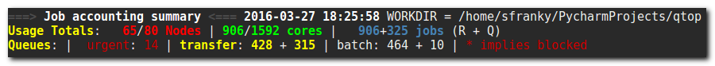
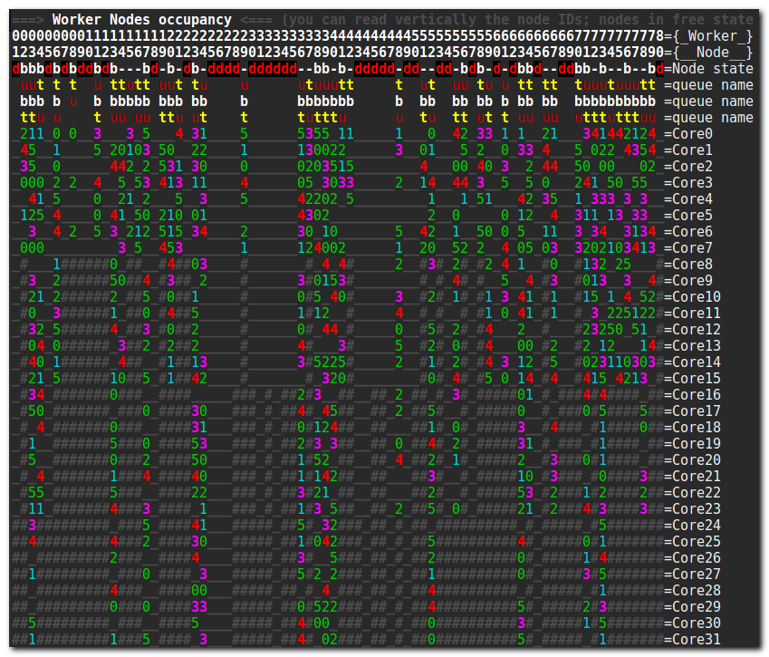
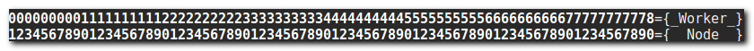
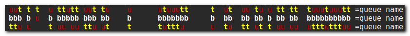
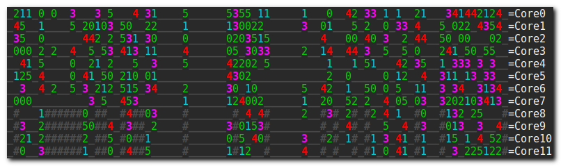
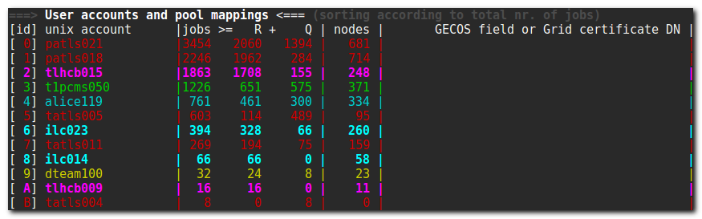

qtop guide
==========

-  [Introduction](#introduction)
-  [Architecture and source map](architecture.md)
-  [Quickstart](#quickstart)
-  [Demo case study](#demo-case-study)
-  [Bundled scheduler case studies](#bundled-scheduler-case-studies)
-  [Output walkthrough](#output-walkthrough)
-  [Watchmode](#watch-mode)
-  [Instant Replay](#instant-replay)
-  [Customisation](#customisation)
-  [Capture and JSON export](#capture-and-json-export)
-  [Command-line arguments](#command-line-arguments)
-  [Usage tips](#usage-tips)

Introduction
------------

### Background

qtop's Python version is based on the original qtop bash script written
by @fgeorgatos long ago. The main reason for rewriting it from scratch
in Python was the drive to add some much-needed functionality, which was
getting harder and harder to do in bash. The Python version is much more
extensible and can support more Local Resource Management Systems, such
as Oracle/Sun Grid Engine (SGE/GE), LSF, LoadLeveler, OAR, SLURM etc.
It's also less buggy, with most of the bugs of the old version eradicated
...and new ones
introduced ;-)

### Goals

qtop summarizes, textually and visually, the state of a Resource
Management System, along with relevant cluster information. It gathers
information from the Resource Management System and organises it in a
compact yet illustrative format for easy access. Expandability and
configurability were deemed very important and were taken into account
from the very early stages of designing qtop. What's more, it is
intended that the information gathered by qtop can be reused by other
developers or system administrators, either for other purposes or in
different visualisation formats/media. For this reason, qtop exports the
gathered information to a convenient JSON format. The project also goes
to great lengths to keep qtop dependency-free. That means, you don't
have to download or install anything extra; qtop works out of the box!

Quickstart
----------

The absolute simplest way to get qtop to display *anything* is by
invoking it in demo mode:

```sh
./qtop -b demo
```

When used, the ``-b`` switch must always be followed by one of the
supported batch systems (pbs, sge, oar, slurm, slurm_json, lsf, htcondor, flux, demo).

That should create and destroy fictional jobs in fictional machines from
fictional users, and display all that in a colorful but not yet very
helpful way. The data produced will probably be more than a screenful,
so most of it is going to scroll up and away. If you want to start
making any sense of it, you're better off trying this:

```sh
./qtop -b demo -w
```

which keeps updating the screen with freshly made-up data, and also
keeps you at the beginning of it. This is called the [watch mode](#watch-mode). You'll notice that this time it's the end that
you cannot see, so now would be a good time to introduce
[keybindings](#keyboard-shortcuts) to move around.

Most of what you can see on screen is customisable **on-the-fly** by
editing a [configuration file](#customisation). Some modifications
can also be accomplished by using the aforementioned
[keybindings](#keyboard-shortcuts).

Demo case study
---------------

Use demo mode when you want to learn qtop's display without access to a
live PBS, SGE, OAR, or Slurm cluster. The demo backend generates fictional
worker nodes, jobs, queues, and users, so it is useful for checking the
layout and keyboard workflow before pointing qtop at production
scheduler data.

Start with a one-shot render:

```sh
./qtop -b demo
```

Then try the same input with common display switches:

```sh
./qtop -b demo -FT
```

This combines two useful view changes:

-  ``-F`` shows full worker node names instead of compact numbers.
-  ``-T`` transposes the worker-node matrix so nodes are rows instead
   of columns.

For a large demo view, let the output overflow horizontally and inspect
it with ``less``:

```sh
./qtop -b demo -l | less -RS
```

For an interactive session, use watch mode. The optional value after
``-w`` is the refresh interval in seconds:

```sh
./qtop -b demo -w 10
```

While in watch mode, the movement keys from [Keyboard shortcuts](#keyboard-shortcuts) let you move through the matrix,
transpose it, switch node ID display, apply filters, or quit.

### NVL72 demo

`-b demo72` simulates one GB200 NVL72 rack, a single NVLink domain: 18 compute
trays (`tray01`..`tray18`), each with 4 GPUs and 144 Grace cores, 36 per GPU.
A training job holds a run of whole trays, inference and debug jobs take 1, 2 or
4 GPUs of one tray, a tray may be down, a full-rack job waits, and one job's GPU
details are missing, so its GPUs show as `?`. The jobs change every 20 seconds:

```sh
./qtop -b demo72 -w 5
./qtop -b demo72 -o accelerator_map=before
```

The trays carry the same Slurm GPU records as live Slurm data, so the
[GPU cells in the matrix](#accelerators-by-node-slurm), `-A`, exports and replay work
as they do on a real cluster.

Bundled scheduler case studies
------------------------------

The ``qtop_py/contrib`` directory contains captured scheduler snapshots
for quick checks without access to a live cluster:

```sh
./qtop -s qtop_py/contrib -c ON -Fadvv -b sge
./qtop -s qtop_py/contrib -c ON -Frdvvv -b oar
./qtop -s qtop_py/contrib -c ON -raF -b pbs
```

Use ``-s`` for saved scheduler files and ``-b`` for the matching parser.

Output walkthrough
------------------

### The three qtop sections

The information that qtop conveys when run can be divided into three
sections:

#### Accounting Summary

-  number of nodes (Total:available (online):Free (non-exclusive))
-  number of cores (available/total)
-  number of jobs (running/queued)
-  queue names, along with running/queued jobs info for every queue



*Accounting Summary*

If a queue is denoted as blocked in the Resource Management System, it
will be marked with an asterisk.

#### Worker Nodes Occupancy

The heart of qtop lies in this sector, which is essentially a matrix
(potentially wrapped at the end of the terminal, resulting in a series
of matrices), modular in nature. There are two ways to visualise the
matrix, one where the columns are worker nodes and the rows are the node
characteristics, and another where the matrix is transposed, i.e. the
**rows** are the worker nodes and the columns are their characteristics.
We'll be referring to the first form in our examples, which was also the
original form used in old qtop.

The default characteristics are the node state, the names of the queues
involved and the job per core allocation table.

This, however, is customisable: as long as there are characteristics of
interest existing in the Resource Management System input file, the User
should be able to describe the characteristic inside the config file and
have a new vector spawn inside the matrix.

One dimension is used to array the worker nodes and another to expand
the worker node characteristics (individual cores, node state,
associated queues etc). 

The default elements displayed are:

Worker node ID (virtual or real node name)



*worker nodes ID*

The options here are either the real full name of the worker nodes, or a
numbering scheme. If the worker node numbering is atypical, e.g. from
``pc23`` there's a jump to ``pc-b-145``, the standard representation
scheme will represent such gaps with non-existent worker nodes, which
might not always be desirable. Hence, a remapping mechanism will be put
in place, giving consistent numbering starting from zero, to all nodes
belonging to the cluster.

Node state


*Node state*

The node state is denoted with the first letter of the state. For PBS,
for example:

-  **j**: job-exclusive
-  **b**: busy
-  **o**: offline
-  **d**: down

The symbol "**-**" is used when the node is free.

Queue names



*Queue name*

The queue names sector shows the initials of the queue names loaded with
jobs running on the specific worker node. The full names of the queues
show up earlier in the Accounting Summary, color-coded in the same way.
So if you have queues all starting with the same letter, e.g. grid3000M,
grid2000M, grid5000M, the colouring will help you see which is which.

Job allocation table



*Cores*

The jobs are displayed via their owner, who is given a single-character
ID. The mapping is shown on the [User account information](#user-account-information) section. An underscore '\_'
denotes a free core. A hash symbol '#' means that the core in this
position does not exist on this worker node. If, for example, a
hundred-node cluster consists of 96 worker nodes of 32 cores and 4
worker nodes of 16 cores, the last 16 core position in those 4 worker
nodes will be substituted with the hash symbol.

#### User account information



*user accounts*

-  ``id`` is a symbol denoting a unique unix account
-  the jobs of every user, with distinct mention for the running jobs
   vs. the total number of jobs (including the finished ones)
-  the name of the unix account
-  optional GECOS details (``-G``) and primary Unix group (``--show-groups``)

Rows follow the displayed ``id`` column: the configured ``possible_ids``
order normally, or alphabetical ID order with ``fill_with_user_firstletter``.
Rows sharing an ID use ascending username order, regardless of job counts.
Overflow rows marked ``*`` appear last, also ordered by username. Sorting the
table does not change user IDs or the color precedence of shared IDs.

``-4`` adds a totals row. ``-G`` retrieves account details with the
configured ``getent passwd`` command; the default cache is
``$HOME/.local/qtop/getent_passwd.txt`` when real-time lookup is disabled.
``--show-groups`` resolves each user's primary Unix group through the local
account database. Neither option requires a Grid pool-mapping command.

IDs are handed out in ``user_id_ranking`` order: with the default
``possible_ids``, ``0``-``9`` go to the top ten users. Count keys come first, each
ranking higher counts first: ``all`` (every job, any state), ``R+Q``, ``R``,
``Q``. The list must end with ``name_desc`` or ``name_asc``, so ties resolve the
same way on every refresh and every replay of a sample. The default
``[all, R, name_desc]`` breaks ties among equal totals by running jobs;
``[all, name_desc]`` reproduces the 2012 shell qtop exactly.

``user_accounts_header`` is the note printed after the table title, at most
200 characters on one line; ``{ranking}`` expands to the active
``user_id_ranking``. ``''`` prints no note, ``--classic`` shows the
scheduler's own note instead, and anonymized samples (``-L -A``) reset it to
the default, since free text may identify the site.

```yaml
user_id_ranking:
  - all
  - R
  - name_desc
user_accounts_header: '(ranked by {ranking})'
```

The state columns after ``jobs >=`` are tunable; the default is ``R + Q + O``
(O, other, counts the jobs in neither state, as in the Summary).
``accounts_states`` lists state keys from ``state_abbreviations``, in display
order; ``other_of_user`` counts jobs in none of the listed states, and an entry
may be a ``{state key: label}`` mapping when first-letter labels collide.
``summary_states`` does the same for the Summary line, shown as
``Total=R+Q+Other`` with blue, green, orange and yellow backgrounds (orange
needs a 256-colour terminal, ``TERM=*256color`` or ``COLORTERM`` set, and is red
elsewhere; with ``-c OFF`` on a terminal the counts are in reverse video). Unset, R
and Q are the scheduler-reported totals and Other counts the listed jobs in
neither state; set, every count comes from the job list instead, which may
differ slightly from the scheduler's own totals.

``summary_colours`` overrides those colours with colormap names, in the order
Total, R, Q, Other; a shorter list is reused in turn. Per-user Total, R and Q
counts and compact queue R/Q counts use the same backgrounds. The independent
Account totals section paints all its state counts like the Summary.

On PBS the default Summary R and Q are ``qstat -q``'s queue totals, while the
accounts table counts ``qstat``'s job list, so the two can differ by a few jobs:
the commands run moments apart, and ``qstat -q`` also counts jobs the job list
may not show. The bundled PBS sample shows ``10955=7590+3365+0`` against a
totals row of ``10954``, ``7588`` R and ``3365`` Q. This is in the input, not
in qtop; set ``summary_states`` to count the job list on both sides.
``qstat -q``'s Que also counts W and H jobs, so Other is only the listed jobs
beyond R and Q; with an empty ``qstat -q`` the Summary counts the job list.

```yaml
accounts_states:
  - running_of_user
  - cancelled_of_user
  - queued_of_user
  - expired_of_user: X
  - other_of_user
summary_states:
  - running_of_user
  - queued_of_user
  - other_of_user
summary_colours:
  - BlackOnBlue
  - BlackOnGreen
  - WhiteOnRed
  - BlackOnGold
```

Slurm default job counts include held/requeued jobs (RD, RH, SE) in Q.
Configuring jobs (CF) already have allocated nodes and count as Other.
The summary and default account columns share normalized accounting; explicit
``accounts_states`` / ``summary_states`` retain the configured detailed states.

### Palettes

``palettes.yaml``, next to ``qtopconf.yaml``, defines the colour palettes; in
watch mode ``p`` cycles forward and ``P`` backward through its ``PALETTES``
list, starting with the first. There are 20 palettes; uncomment the extra
entries in that list to enable them.
The active list contains, in order, ``default``, ``green-monitor`` (monochrome in
phosphor-green tones), ``solarized-dark``, ``gruvbox``, ``okabe-ito``
(colour-blind safe) and ``monochrome`` (bold, underline and reverse). A palette
maps colormap colour names to ANSI SGR codes, digits and ``;`` only, and keeps
the default colour for any name it leaves out. A ``palettes.yaml`` in the system
directory or ``~/.local/qtop/`` reorders the list or changes palettes, colour by
colour. The palettes use 256-colour codes and leave the terminal background alone.

Startup prints a flushed dot to stderr when each scheduler source first opens
and closes (three sources produce six dots). Later refreshes stay quiet.

Watch mode
----------

The watch mode is a step-up from the original implementation, where the
user was able to run qtop with ``watch -d`` prepended, so as to be able
to watch an almost real-time evolution of the system monitored. Alas,
there was no way to retain qtop's coloring information with watch (not
in older versions of watch, anyway). An in-house implementation of watch
was hence inspired, and along with that came new features that original
watch doesn't provide, giving interactivity to the user, in an
ncurses-like fashion.

Watch mode supports:

-  navigation through a big matrix, as if more/less were used (more or
   less ;) with vim-like commands
-  matrix transposition (switch between rows<->columns)
-  node ID type switch (from proper full node name to bare numbering)
-  coloring code switch (user id coloring/queue coloring)
-  real-time filtering of nodes according to name substring or
   RegEx/node state/node number

### Keyboard shortcuts

#### Navigation

| shortcut | function |
| --- | --- |
| j / Space | go down one screen |
| k / Backspace | go up one screen |
| h / l | go left / right one screen |
| g / K / Home | go to the first displayed line |
| G / J / End | go to the last page |
| 0 / $ | go to the left / right edge |
| R | reset the viewport |
| Up / Down arrows | move one displayed row |
| Left / Right arrows | move horizontally |
| PageUp / PageDown | move one page |
| /text, Enter | search forward for literal text; wrap at the end |
| :42, Enter | jump to displayed line 42 (one-based) |

#### View and session controls

| shortcut | function |
| --- | --- |
| f | apply filtering |
| F | switch full names / numbered node labels |
| H | highlight users or queues |
| m | switch core coloring by user / queue |
| p / P | cycle palettes forward / backward in ``palettes.yaml`` |
| Q | cycle compact / expanded / clipped / hidden Queueing layouts |
| r | cycle all / real / used CPU lines |
| s | apply sorting (remapped matrices; numbered ones keep node order) |
| S | stack each node's jobs from its first core / show scheduler core placement (``stack_jobs_per_node``) |
| t | transpose the matrix |
| 1, 2, 3 | show / hide sections 1-3 (as ``-1``, ``-2``, ``-3``) |
| 4 | show / hide independent section 4, Account totals (as ``-4``) |
| ? | toggle interactive help |
| q | quit qtop |

Searches include wrapped text and ignore ANSI colour sequences. An empty search
reuses the previous text. Escape cancels a prompt; Backspace edits and Ctrl-U
clears it. Addresses refer to displayed rows at the current terminal width.
Bare `1` toggles section 1 immediately; `G` goes to the bottom independently.
Queued keys are read on successive UI cycles;
synchronous scheduler collection/rendering still takes time within each cycle.

Instant Replay
--------------

The output of qtop is kept in ``/tmp/qtop_results_$USER`` (configurable
in ``qtopconf.yaml``), so that users can "replay" the state of their
system from a particular point in time. By default, the output is kept
for the last 24 hours, but this is also configurable in
``qtopconf.yaml``.

To replay from a specific point in time, the User must invoke:

```sh
./qtop -R DATETIME [DURATION]
```

where ``DATETIME`` can be one of:

-  ``yyyymmddTHHMMSS``, e.g. ``20161118T182300`` (explicit form)
-  ``HHMM``, e.g. ``1823`` (current day is implied, or the previous day,
   depending)
-  ``mmddTHHMM``, e.g. ``1118T1823`` (current year is implied)

Colons, slashes and dashes are also supported, so the User can type,
e.g. 18:23, or 11/18T18:23, instead.

A second value, ``DURATION``, is optional and denotes the desired length
of the playback. The notation for duration is ``X<unit>``, where unit
can either be ``h``, ``m``, ``s``. Example:

```sh
./qtop -R 1823 1h
```

A default duration of ``2m`` is used, if no value is given.

*Important*: What is displayed on screen during instant replay is what
was displayed at that particular moment. If the User was navigating up
and down while using filters, this is what is going to be displayed.

Customisation
-------------

Customisation is achieved by means of editing a configuration file.
Modifying most of the keys available in the configuration file can
affect the behaviour of qtop in a live manner, if running in [watch mode](#watch-mode).

### The configuration file (qtopconf.yaml)

#### Configuration lookup and precedence

qtop applies settings in this order; later values replace earlier ones:

1. The bundled ``qtopconf.yaml`` in the source checkout or package.
2. ``/etc/qtopconf.yaml``, when present.
3. ``$HOME/.local/qtop/qtopconf.yaml``, when present.
4. The file selected by ``-f FILE``. Relative names are searched in
   ``$HOME/.local/qtop`` first, then the directory where qtop was launched;
   an absolute path selects that file directly. A selected file must exist.
5. Repeated ``-o KEY=VALUE`` overrides, processed from left to right.
   Dedicated CLI switches also apply their documented display behavior.

File overrides replace whole top-level values rather than recursively merging
nested mappings, with three exceptions: ``schedulers``, ``signature_commands``
and ``state_abbreviations`` merge per backend and, within one backend, per key.
Their defaults come from each backend in ``qtop_py/plugins/``; a layer sets only
what it changes, for example one command:

```yaml
schedulers:
  slurm:
    sinfo_file: %(savepath)s/sinfo%(pid)s.txt, sinfo -N -h -O 'NodeList:0|,Partition:0|,StateCompact:0|,CPUs:0'
```

``-o`` accepts top-level keys, not dotted paths. Values are parsed as Python
literals where possible (for example ``True``, ``1``, or a list); other values
remain strings. It does not execute Python expressions. Use a configuration
file for nested settings and values normalized during configuration loading,
such as color mappings. For example:

```sh
./qtop -b demo -o rem_empty_corelines=1 -o auto_delete_old_output_files_after=48h
```

Scheduler selection has its own precedence: ``-b``, then ``QTOP_SCHEDULER``,
then the configured ``scheduler``. A selected value of ``auto`` triggers
command discovery at that point. ``QTOP_COLOR`` supplies the color preference
when ``-c AUTO`` is used.

Use one setting for all qtop intermediate files, including background collection
and archive-extraction workspaces, rendered frames, traces, exports and captures:

```console
./qtop -w -o 'savepath=/dev/shm/qtop_$USER'
```

Or set ``savepath: /dev/shm/qtop_$USER`` in your configuration. If qtop cannot
create or verify that directory (for example a refused symlink or a foreign
owner), it prints a warning and, as a best effort, uses a private
``qtop_fallback_<uid>`` directory under ``/dev/shm``, else the system temporary
directory, or under ``$QTOP_FALLBACK_DIR`` when that is set. The persistent
diagnostic log remains under ``~/.local/qtop/logs/`` and falls back the same
way; if no log location works, qtop runs without a log file. The fallback goes
through the same private-directory checks; ``--strict-parents`` (or
``--strict``) stops with the original error instead. Input files remain where
supplied; this setting does not relocate the log or Python bytecode.

The ``savepath`` expands environment variables and is created with permissions
``0700`` (accessible only to its owner). This also applies to ``-o savepath=...``;
use an absolute path. On macOS, the standard root-owned `/tmp` and `/var`
aliases are expanded into `/private` before validation. A root-owned symlink
in a parent directory that others cannot write, such as an autofs or NFS
``/home -> /nfs/home``, is followed; qtop verifies ownership and rejects other
symlink components, and never follows one for a directory it owns. Existing directories owned by the current
user are automatically restricted to ``0700``, including group/other-writable
output directories and the ``~/.local/qtop`` configuration/log tree. Unrelated
writable parent directories require the sticky bit, as on ``/tmp``;
non-writable site-owned parents are allowed. qtop does not change ownership or
permissions on unrelated ancestors.

The source launcher uses Python isolated mode (``-I``), importing qtop from its
own checkout rather than the caller's directory or ``PYTHONPATH``. It remains
compatible with Python 3.6; optional packages installed only in the user site
are not loaded by this launcher.

#### YAML Format

YAML was chosen as it is human-readable and should thus be easier for
people to read and modify to their liking. That said, the configuration
file is in a YAML-**like** format. It does not faithfully follow the
format 100%, as it was written quickly. It was decided against using the
standard PyYAML module because qtop should keep its runtime dependency
surface minimal. Users often run qtop on early or bare HPC systems where
extra Python packages, internet access, or administrator-managed Python
stacks may not be available.

This has, unfortunately, resulted in some "quirks" in the YAMLish format
now used, such as:

-  having to end single-item lists in a comma, e.g. ``['^wn-26',]``
-  two consecutive unindents not being allowed. There must always exist
   a once-unindented key-value after nested keys
-  not being able to write arbitrarily deeply nested dictionary-like
   structures, without fear it's going to break the universe.

Anyone brave enough to dive into ``core_yaml_parser.py``, or better still,
rewrite the darn thing, is more than welcome to, by the way. It goes
without saying that only a very basic implementation is required (what
you can see used in the configuration file, really!) and none of the
flashy features that YAML sports.

Merged configuration files and CLI overrides are checked before the output
directory is created and before scheduler collection.
Invalid common settings report the affected key (for example, `sorting.reverse`
or `term_size`). Backend-specific extension keys remain supported.

`scheduler_command_timeout` also bounds optional user-detail commands from
`extract_info`; it defaults to 180 seconds and must be positive and finite.
Set it in your `qtopconf.yaml`, or use `-o scheduler_command_timeout=240`.
Failed or timed-out lookups log a warning and leave the dashboard usable.
Quoted command arguments, including cache paths containing spaces, are preserved.

#### Scheduler configuration area

PBS node input tolerates blank separators and wrapped `jobs` attributes. Array
allocations retain exact task IDs when the job snapshot includes those tasks;
otherwise a reported parent may supply their user/queue association. Unknown
tasks retain their IDs. Legacy job tables support underscore usernames and full
queue names; legacy queue tables accept numeric node limits.

SGE whole-node queues are opt-in. A running job in a queue matching
`sge_whole_queues` (exact names or `fnmatch` globs, matched before
anonymization) is drawn on every free core up to the node's `num_proc`; cores
held by other jobs are kept, and idle nodes stay idle. Unset or empty disables it:

```yaml
sge_whole_queues:
  - world
  - whole*
```

```yaml
savepath: /tmp/qtop_results_$USER
schedulers:
  pbs:
    pbsnodes_file: %(savepath)s/pbsnodes_a%(pid)s.txt, pbsnodes -a
    qstatq_file: %(savepath)s/qstat_q%(pid)s.txt, qstat -Q -f -F json
    qstat_file: %(savepath)s/qstat%(pid)s.txt, qstat -f -F json
  oar:
    oarnodes_s_file: %(savepath)s/oarnodes_s_Y%(pid)s.txt, oarnodes -s -Y
    oarnodes_y_file: %(savepath)s/oarnodes_Y%(pid)s.txt, oarnodes -Y
    oarstat_file: %(savepath)s/oarstat%(pid)s.txt, oarstat
  sge:
    sge_file: %(savepath)s/qstat%(pid)s.F.xml.stdout, qstat -F -xml -u '*'
  slurm:
    ## Copy the command after ', ' directly into a shell for debugging.
    squeue_file: %(savepath)s/squeue%(pid)s.txt, squeue -r -h -O 'JobID:0|,UserName:0|,StateCompact:0|,Partition:0|,NumCPUs:0|,NodeList:0|,tres-alloc:0|,tres-per-node:0|,tres-per-task:0|,ArrayJobID:0|,ArrayTaskID:0'
    sinfo_file: %(savepath)s/sinfo%(pid)s.txt, sinfo -N -h -O 'NodeList:0|,Partition:0|,StateCompact:0|,CPUs:0|,Gres:0|,GresUsed:0|,Available:0'
    scontrol_file: %(savepath)s/scontrol%(pid)s.txt, scontrol --details show jobs
    topology_file: %(savepath)s/topology%(pid)s.txt, scontrol show topology
  demo:
    demo_file: %(savepath)s/demo%(pid)s.txt, echo 'Demo here'
```

The Slurm commands after the filename separator can be copied directly into
a shell:

```sh
squeue --states=all -r -h -O 'JobID:0|,UserName:0|,StateCompact:0|,Partition:0|,NumCPUs:0|,NodeList:0|,tres-alloc:0|,tres-per-node:0|,tres-per-task:0|,ArrayJobID:0|,ArrayTaskID:0'
sinfo -N -h -O 'NodeList:0|,Partition:0|,StateCompact:0|,CPUs:0|,Gres:0|,GresUsed:0|,Available:0'
```

Quotes keep the pipe characters inside the format argument. qtop honors
shell-style argument quoting without invoking a shell. Existing custom
configurations using doubled ``%%`` format codes remain supported.

qtop runs scheduler commands with ``LC_ALL=C`` and ``SLURM_BITSTR_LEN=0``.
The latter stops Slurm cutting long pending array task ranges (such as
``453906_[2,6-14,21-26,...]``) at its default length; set it too when
copying the commands above. A saved trace whose array range was cut still
loads: that row is skipped and reported as a rejected job row, so the
pending tasks it held are missing from the counts (qtop/qtop#606).

The bundled `squeue` command explicitly selects all states still retained by
the controller, including suspended jobs. This is not historical accounting;
recently finished jobs may also appear in user totals while Slurm retains them.
Custom `squeue` commands should include `--states=all` too.

By default, Slurm's partition visibility rules apply. Use `qtop -b slurm --all`
to include hidden and group-unavailable partitions, subject to Slurm permissions.
This adds `--all` to the existing `squeue`, `sinfo`, and `scontrol` queries, without
adding commands. It does not broaden an explicit partition/user filter in a custom
command. Other backends and saved-trace/sample replay are unaffected; replay can
only show the data captured. The existing `-a` option remains blind remapping.

If Slurm rows are rejected, or active jobs reference missing nodes or invalid
node lists, qtop displays `WARNING: Slurm snapshot incomplete` with counts and
an `INFO:` next step for each case: `--all` for missing nodes (they may be in
hidden partitions), a starting/completing job or a cut `NodeList` field for
invalid node lists, and the command formats in `qtopconf.yaml` for rejected rows.
Scheduler messages appear together at the end of each frame, even when display
sections are disabled. `INFO:` labels accounting and CPU-ID explanations;
`WARNING:` labels incomplete snapshots, estimated placement and omitted CPU
assignments. Valid jobs
and queues remain visible; unavailable node capacity is not invented. JSON and
support replay preserve optional `slurm_diagnostics` counters:
`rejected_squeue_rows`, `rejected_sinfo_rows`, `jobs_with_missing_nodes`, and
`jobs_with_invalid_nodelists`, `jobs_from_scontrol` (running jobs with accelerators
listed from `scontrol` because `squeue` missed them), and `all_partitions: 1` when live
collection used `--all` (replayed traces do not say). Clean snapshots collected without `--all` omit this field. Row counts refer
to input records, not an estimate of how many jobs or nodes those records hid.

Slurm accepts legacy six-column and resource-aware nine-column `squeue`
traces, plus the eleven-column identity-aware format above. `sinfo` accepts
four or six columns, or five/seven with partition availability appended.
The default `sinfo` command includes `Available` (`%a` in compact format).
The queueing line marks partitions in `down`, `drain`, or `inact`/`inactive`
state with `*`; `up` partitions remain unmarked. Partition availability is
separate from node health: a down node does not by itself block a partition.
Older traces without availability report queue state `?` and no blocking
marker. If rows disagree, blocking states take precedence over `up` or unknown.
The raw partition state is exported in each queue's `state` field and survives
capture/replay, including anonymized snapshots.

Slurm nodes also retain their original compact state in `slurm_node_state`,
including suffix flags. The node-state matrix shows the final suffix character
when present (for example `idle*` shows `*`, `idle~` shows `~`, and `idle#`
shows `#`). Unflagged nodes keep the existing normalized state symbol.
The normalized `state` remains available for accounting and filtering; the raw
Slurm state survives JSON export and capture/replay, including anonymization.

The appended `ArrayJobID` and `ArrayTaskID` fields are
the primary array identity; missing fields fall back to the formatted job ID.
For ordinary jobs Slurm reports `ArrayTaskID=N/A`, so their numeric
`ArrayJobID` is not interpreted as array membership. Conflicting scalar
identities are rejected; complete explicit fields can recover a truncated
display ID. JSON preserves `slurm_array_job_id` / `slurm_array_task_id` and
`slurm_het_job_id` / `slurm_het_job_offset`, retaining canonical IDs for
compatibility. Anonymized snapshots mask parent IDs consistently while
preserving task/component indices and core references. `squeue -r` emits individual array tasks, avoiding
compressed or truncated array IDs. Complete grouped IDs in older traces are
expanded into individual tasks, including lists, stepped ranges and concurrency
limits. Expansion is limited to 100,000 grouped tasks per frame; malformed,
truncated or oversized groups produce an actionable error instead of a partial
count. Identical duplicate task rows are deduplicated; conflicting rows are
rejected. Slurm job counts use individual array tasks and heterogeneous
components. Components keep distinct IDs and allocations, even when they share
one heterogeneous submission; the summary states this accounting unit.
Pending jobs eligible for multiple partitions appear in each real partition,
with one unique job in global totals. Per-partition counts therefore need not
sum to the global total. JSON retains the eligible names in `slurm_partitions`
and the counting category in `accounting_state`. Compatible pending rows
repeated by `squeue -P` are merged.

The extra job columns preserve TRES allocation
(or requests for pending jobs), resources per node and resources per task;
node columns preserve configured GRES and GRES usage. These raw fields are
available in JSON; GPU occupancy rendering is not implemented yet. Named
fields use width zero so long resource descriptions are not truncated.

GPU metadata is also normalized into node fields `slurm_gpu_configured`,
`slurm_gpu_used`, and (when job detail records are available)
`slurm_gpu_bindings`. Each resource has `type`, `count`, `device_indices`,
`mig_profile`, and `parent_gpu_uuid`; bindings additionally have `job_id`.
Bindings come only from per-node `GRES=` records in `scontrol --details show jobs`,
never from requested TRES or aggregate node usage. Multiple jobs can retain
bindings to the same resource. These fields are exported and replayed without
adding GPU visualization.

For example, `gpu:h100_nvl:2(IDX:0,7)` binds two Slurm resources, while
`gpu:h100_1g.12gb:1(IDX:8)` identifies a MIG-profile resource. Indices are
node-local Slurm GRES indices, not CUDA ordinals, Linux device numbers, or
physical parent GPU indices. Counts may represent MIG instances rather than
whole cards. Recognizable profile names are retained; a null profile means
unknown, not proof that a resource is a whole GPU. Socket affinity is not
device identity. Missing indices remain null, and parent GPU UUIDs remain null:
the current scheduler traces do not supply a trustworthy MIG-to-parent mapping.
No eight-GPU topology is assumed by the parser. Malformed or inconsistent GPU
detail records do not create bindings. Missing detail records mean unknown
placement, not zero allocation. Anonymized snapshots retain indices, counts,
profiles and masked job references while removing resource type strings and UUIDs.

See [Slurm MIG management](https://slurm.schedmd.com/gres.html#MIG_Management).

Slurm also supports compact GPU-related fields: `squeue -o '%b'` reports
per-node TRES requests and `sinfo -o '%G'` reports configured GRES. They do not
replace all the allocation, per-task and GRES-usage fields collected above,
so qtop uses the named formats to retain that information.

The default configuration also collects scheduler CPU positions through
`scontrol_file`. Existing custom scheduler configurations can add that entry
from the example above. Comment it out to disable live detail collection.
Its command is:

```sh
scontrol --details show jobs
```

For offline input, save that output as `scontrol.txt` alongside `squeue.txt`
and `sinfo.txt`; qtop discovers it automatically. The file is optional.
Missing, failed, malformed or inconsistent details use the existing estimated
placement. Each node exports `cpu_allocation_source` (`slurm`, `estimated`, or
`none`); the scheduler messages block identifies estimates. Valid detail records use
Slurm abstract CPU IDs, which are not Linux CPU IDs or task affinity masks.
Overlapping allocations also use estimates because the current core map can
represent only one job per CPU. Estimated placement fills available capacity
across uneven node sizes. Each node retains all active job IDs in
`slurm_job_ids`, including jobs sharing CPUs, so per-user node counts remain
complete. If assignments exceed matrix capacity, `slurm_unmapped_cpus` records
the omitted count once per affected job, and the legend reports it.
Capture commands close together to limit races.
Anonymized snapshots retain placement provenance but omit opaque TRES/GRES
strings; ordinary exports and raw trace archives preserve them.

See [Slurm CPU management](https://slurm.schedmd.com/cpu_management.html),
[squeue fields](https://slurm.schedmd.com/squeue.html) and
[sinfo fields](https://slurm.schedmd.com/sinfo.html).

There are two ways to run qtop, data-wise:

1. run it on a batch controller (Computing Element), or similar host,
   where qtop itself invokes the commands needed to gather the cluster
   information
2. run it wherever, after the cluster information has been stored locally
   for qtop to read

The second mode is handy for off-line debugging of qtop, running it in
GitHub Codespaces, or using bare Linux containers on a laptop while away
from the cluster.

In this area of the configuration file, two key elements are set for
each scheduler:

-  the needed shell commands to run on the Computing Element
-  the filepath where the cluster information is to be saved

So, let's say your nick is Mike and you are administering an OAR
cluster. If you just invoke:

```sh
./qtop -b oar
```

then qtop is going to invoke ``oarnodes -s -Y``, ``oarnodes -Y``,
``oarstat`` consecutively. OAR's header and queue summary count running (`R`)
and waiting (`W`) jobs from the same `oarstat` snapshot. Each job counts once,
regardless of how many resource slots it uses; other states remain in the user
job totals. Custom queue names are supported. Queue limits and availability
are reported as unknown because this snapshot does not supply them; only queues
present in the job snapshot can be listed. No extra
commands or `--StrictCheck` are required.

OAR resource parsing accepts quoted job IDs, comma-separated or YAML job lists,
and blank lines. Shared slots display one known owner; `oar_job_ids` retains all
owners for node membership, queue filtering, export, and replay. Allocated slots
whose owner is absent from `oarstat`, or whose resource details are missing,
display `?` rather than appearing free. A per-frame allocation note reports
inconsistent snapshots and shared slots; `oar_diagnostics` preserves these counts.
Resources absent from the node-state snapshot are reported, without inventing
hostnames or capacity. StrictCheck compares unique known running job IDs across
the unfiltered snapshot, not user symbols or occupied resource counts.

With process ID ``12345`` and ``USER=mike``,
its live captures are:

```text
/tmp/qtop_results_mike/oarnodes_s_Y_12345.txt
/tmp/qtop_results_mike/oarnodes_Y_12345.txt
/tmp/qtop_results_mike/oarstat_12345.txt
```

The ``%(pid)s`` filename placeholder becomes ``_<process ID>`` for live
collection and an empty string with ``-s``. The ``%(savepath)s`` placeholder
uses the selected working directory. Command strings honor shell-style
quoting but are executed without a shell: use shell redirection when manually
collecting traces, not inside the configured command.

If, instead, you invoke it as follows:

```sh
./qtop -b oar -s <path-to-cluster-information>
```

qtop will search for ``oarnodes_s_Y.txt``, ``oarnodes_Y.txt`` and
``oarstat.txt`` in ``<path-to-cluster-information>`` (retrieved by you,
earlier).

For Slurm, qtop expects saved ``squeue`` and ``sinfo`` command traces
matching the configured commands. For example:

```sh
./qtop -b slurm -s <path-to-slurm-command-traces>
```

qtop will search for ``squeue.txt`` and ``sinfo.txt`` in
``<path-to-slurm-command-traces>``.

Saved snapshots use these default filenames (custom configurations may change
them):

| Backend | Files expected with ``-s DIRECTORY`` |
| --- | --- |
| PBS | ``pbsnodes_a.txt``, ``qstat.txt``, ``qstat_q.txt`` |
| OAR | ``oarnodes_s_Y.txt``, ``oarnodes_Y.txt``, ``oarstat.txt`` |
| SGE | ``qstat.F.xml.stdout`` |
| Slurm | ``squeue.txt``, ``sinfo.txt`` |

For manual Slurm collection on a scheduler host:

```sh
qtop_trace_dir=$(mktemp -d)
SLURM_BITSTR_LEN=0 squeue -r -h -O 'JobID:0|,UserName:0|,StateCompact:0|,Partition:0|,NumCPUs:0|,NodeList:0|,tres-alloc:0|,tres-per-node:0|,tres-per-task:0|,ArrayJobID:0|,ArrayTaskID:0' > "$qtop_trace_dir/squeue.txt"
sinfo -N -h -O 'NodeList:0|,Partition:0|,StateCompact:0|,CPUs:0|,Gres:0|,GresUsed:0|,Available:0' > "$qtop_trace_dir/sinfo.txt"
./qtop -b slurm -s "$qtop_trace_dir"
```

qtop also has a scheduler-type discovery system, meaning it will try to
guess which scheduler system is installed in your system. Each backend
declares the command that characterises it (``signature_command``) and a
``detection_priority``: Slurm (``sinfo``) first, then Slurm JSON, PBS
(``pbsnodes``), OAR, SGE, LSF, HTCondor and Flux, so that an unrelated ``qstat``
command does not mask an available ``sinfo`` command. Override one in a
configuration layer:

```yaml
---
    signature_commands:
      lsf: lsid
---
```

#### XML parsing

SGE XML uses the standard-library parser, which rejects DTD declarations.
No additional XML package is required. The former ``faster_xml_parsing`` setting
never switched the parser to ``lxml`` and has been removed; a configuration that
still sets it is accepted and the value ignored.

#### State abbreviations

Each backend declares its complete mapping as ``state_abbreviations`` in its
module under [qtop_py/plugins/](../qtop_py/plugins/); a configuration layer
overrides single states. For example, the Slurm mapping includes:

| Job state | Accounting category |
| --- | --- |
| ``R`` | ``running_of_user`` |
| ``PD`` | ``queued_of_user`` |
| ``RH`` | ``hold_of_user`` |

These categories feed user accounting. An unrecognized state remains in
user job totals without being classified as running or queued, and qtop
logs a warning. When changing a mapping, retain the other backend entries
because file overrides replace the complete top-level mapping.

#### Color mappings

```yaml
---
    user_color_mappings:  # order should be from more generic-->more specific
    # - \w+: Gray_D  # enabling this cancels all saved accounts in colormap.py
    # - [\d]+: Gray_D
    # - [A-Za-z]+0\d{2}: Red_L
    # - [A-Za-z]+15\d: Gray_D
    # - \w*lhc\w*: Cyan_L
    # - \w+00\d: Blue
    # - \w*cms\w*: Red_L
     - \w*cms048: Blue
     - \w*cms193: Gray_L
     - \w*atl\w+: Red
     - snielsen: Blue
     - ekalesaki: Cyan_L
     - zzhang: Red_L
     - mmravlak: Red_L
     - dbobbili: Cyan_L
     - patls021: Cyan_L

    queue_color_mappings:
      - alice: Red_L
      - dteam\w+: Cyan_L

    nodestate_color_mappings:
     - au: BlackOnRed
     - d: Red_LOnGrayBG
---
```

Color mappings apply for now to three types of items:

-  user ids
-  queue name initials, in the queue name lines/columns
-  node state

Color mappings can be described using [regular expressions](https://docs.python.org/3/library/re.html). The standard
Python regular-expression module ``re`` is used for parsing. Order here
matters, so the expressions on the top of the list get overwritten by
expressions on the bottom.

Colors with backgrounds can also be used: for all the color combinations
available, check ``color_to_code`` dictionary in ``colormap.py``.

In there, you will also find a ton of ready-made colormaps
(``user_to_color_default`` dictionary), with a primary focus on
user ids found in Large Hadron Collider related clusters (WLCG grid).

Capture and JSON export
-----------------------

### JSON export

``-E`` writes one ``qtop_json_<YYYYmmddTHHMMSS>_<random>.json`` file per
snapshot in ``savepath`` (default ``/tmp/qtop_results_$USER``). The terminal
view remains on stdout; ``-O`` suppresses that view. Redirecting stdout does
not capture the JSON. Watch mode can produce multiple JSON files.

From a source checkout, export the bundled synthetic Slurm fixture to a fresh
directory and inspect it:

```sh
qtop_export_dir=$(mktemp -d)
./qtop -b slurm -s tests/plugins/slurm_samples/basic -E -O -o "savepath=$qtop_export_dir"
python3 -m json.tool "$qtop_export_dir"/qtop_json_*.json
```

The export contains three top-level arrays:

| Field | Contents |
| --- | --- |
| ``jobs`` | Records with string ``id``, ``user``, ``state`` and ``queue`` fields. State codes are backend-specific. |
| ``nodes`` | Backend records such as ``domainname``, ``np``, ``state``, ``qname`` and ``core_job_map``. Extra fields and ``np`` types vary by backend. JSON core-map keys are strings. |
| ``queues`` | Records with ``name``, string ``limit``, integer ``queued`` and ``running`` counts, and ``state``. Unknown limits may be ``"--"``. |

Export happens before presentation filtering, ID assignment and colorization;
it does not represent the current filtered viewport. The current payload has
no schema-version or capture-timestamp field; the filename supplies a local
capture time. Empty collections are arrays. Keep backend-specific fields when
processing exports rather than assuming all backends have identical records.

Excerpt from the basic synthetic Slurm export (first record of each array):

```json
{
  "jobs": [
    {
      "id": "101",
      "user": "alice",
      "state": "R",
      "queue": "compute"
    }
  ],
  "nodes": [
    {
      "domainname": "node001",
      "np": "4",
      "state": "-",
      "qname": [
        "compute"
      ],
      "core_job_map": {
        "0": "101",
        "1": "101"
      }
    }
  ],
  "queues": [
    {
      "name": "compute",
      "limit": "--",
      "queued": 0,
      "running": 2,
      "state": "E"
    }
  ]
}
```

### Support archives

``-L`` writes ``qtop_sample_${USER}.tar`` in ``savepath`` by default. A normal
completed one-shot run includes the rendered ``qtop_fullview_*.out``,
``qtop.log`` and scheduler trace files. ``-LL`` additionally includes the
bundled ``qtopconf.yaml``, effective configuration in ``qtop-effective-config.json``,
Python sources under ``qtop_py/``, help text, web assets, a launcher and license.
Source subdirectories such as ``plugins/`` and ``ui/`` are preserved.
The configuration JSON records user and command-line overrides for diagnosis;
it is not a ``--config`` file. Cluster-state JSON exports remain separate files.

Create an extended archive from the same synthetic fixture and list its
members before sharing:

```sh
qtop_capture_dir=$(mktemp -d)
./qtop -b slurm -s tests/plugins/slurm_samples/basic -LL -o "savepath=$qtop_capture_dir"
tar -tf "$qtop_capture_dir"/qtop_sample_*.tar
```

``overwrite_sample_file: True`` replaces the previous archive for the same
user. Setting it to ``False`` adds a ``_YYYYmmdd-HHMMSS`` timestamp. Missing or
unreadable archive members are logged and skipped, so inspect both the member
list and log if a capture appears incomplete.

### Read scheduler traces from a tarball

Pass a tarball directly to ``-s`` to replay native scheduler input:

```sh
./qtop -b slurm -s /path/to/capture.tar.gz
```

Plain, gzip, bzip2 and xz tar archives are supported. Members are grouped by
parent directory and shared capture suffix: ``squeue_123.txt``, ``sinfo_123.txt``
and ``scontrol_123.txt`` form one set. Required files must all be present;
Slurm's ``scontrol`` details and ``topology`` blocks are optional. qtop prefers sets with more configured
files, then the lexicographically last directory/suffix, independent of member
order. This ordering does not infer capture time. Duplicate members make a set
ambiguous and ineligible. ``-d`` logs the selected set and member names.

Only selected regular trace files are copied into a private temporary directory,
which is removed at exit. Links, devices and unsafe member paths are ignored;
archived configuration and sources are not loaded. Limits are 10,000 members,
1 GiB of uncompressed archive data, 256 MiB per trace and 512 MiB per selected set.
Raw companion input-key names and native files under ``masked-traces/`` are
accepted. An archive containing only normalized state needs ``--load-sample``.
Passing a plain output file to ``-s`` continues to use its parent directory.

### Anonymization scope

Use ``-A`` to mask identifiers. For example:

```sh
qtop_masked_dir=$(mktemp -d)
./qtop -b slurm -s tests/plugins/slurm_samples/basic -L -A -o "savepath=$qtop_masked_dir"
tar -tf "$qtop_masked_dir"/qtop_sample_*.tar
```

With ``-L -A -e``, the archive includes ``qtop-snapshot.json`` containing
anonymized parsed state, sanitized effective configuration, display options,
qtop/Python versions and a UTC capture timestamp. Users, nodes, queues and job
IDs receive consistent replacements (such as `u_anon_user_0`, `n_anon_wn_0`,
`q_anon_q_0`); core-to-job links remain intact. Plain ``-A``, with or without
``-w``, masks the displayed state the same way. The
archive uses the name ``qtop_sample_anonymous.tar`` (with a timestamp when
configured). It also includes the masked rendered screen and a short
``capture-log.json`` status record, rather than the original log.

Reproduce it directly, without extracting files or contacting a scheduler:

```sh
qtop --load-sample /path/to/qtop_sample_anonymous.tar
```

Add ``-E`` to export the reproduced state or ``-O`` to save its screen without
printing it. ``-o`` overrides remain available. Loading a snapshot ignores local
configuration and ``QTOP_SCHEDULER``; it cannot be combined with ``-b``, ``-s``,
``-f``, ``-L``, ``-A``, ``-w`` or ``-R``. Use the same qtop version for reliable
rendering. The displayed wall-clock timestamp can differ.

This reproduces the **parsed state and presentation**, including counts and
job/core associations. It does not replay vendor output parsing. Raw scheduler
traces are excluded by default. Local commands, paths, account-detail lookups
and node-remapping rules are replaced or disabled; name-based color/filter rules
are translated to the replacement identifiers. ``omitted_config`` records the
configuration categories that were reset. ``-LL -A`` adds package sources but
omits the bundled configuration file.

For parser investigations, opt into one or both additional outputs:

```sh
./qtop -b slurm -L -A -e --masked-traces --raw-companion
```

``--raw-companion`` writes a separate ``qtop_raw_traces_*.tar`` in the private
save directory **before parsing**. It contains exact unmasked scheduler input
bytes, including malformed records, with members named by scheduler input key
(for example, ``squeue_file``). The path is printed on stderr. This archive is
private evidence, separate from the anonymous archive; review it before sharing.
It does not include logs or configuration. It remains available if parsing fails.

``--masked-traces`` adds ``masked-traces/`` to the anonymous archive. Supported
formats include Slurm pipe-delimited jobs/nodes and key/value job details,
PBS JSON jobs/queues and tabular jobs/queues/node records, OAR tabular jobs and
resource YAML, and SGE XML without DTDs. Masking reuses snapshot identifiers,
redacts other data fields and may reformat records. Resource details, extension
fields and unknown values may be redacted; this is experimental debugging input,
not an exact copy or a guarantee of identical parser behavior.
Unsupported or malformed files are omitted entirely and listed by input key in
``masked-traces/report.json``; they are never copied through unmasked.
Extract supported files into a private directory to parse them with ``-b`` and
``-s``; ``--load-sample`` continues to use only the normalized snapshot.
Both options require ``-L -A -e`` and add no trace-processing work without opt-in.

Standalone ``-A -e`` retains backend-specific masking. Original traces and logs
remain on disk. Sources added by ``-LL`` can still
contain information outside the identifier mapping, so review these before
sharing. Masking does not make the entire working directory safe to publish.

Command-line arguments
----------------------

The command shown in the README, ``./qtop``, is the project wrapper
script. Installed packages expose the same entry point as ``qtop``.
Run ``./qtop --help`` to see the authoritative option list for your
checkout.

### Input selection

-  ``-b SYSTEM`` selects the scheduler backend. Common values are
   ``demo``, ``pbs``, ``sge``, ``oar``, ``slurm``, ``slurm_json``, ``lsf``, ``htcondor`` and ``flux``.
-  ``-s DIRECTORY`` / ``--SetSourceDir`` reads scheduler output files from
   ``DIRECTORY`` instead of running commands. Passing an existing output file
   selects its parent directory; qtop still needs all files for that backend.
-  ``--load-sample ARCHIVE`` reproduces a portable anonymized support snapshot.
-  ``-f FILE`` uses a custom qtop configuration file.
-  ``-o KEY=VALUE`` overrides a top-level option; repeat it for multiple values.

### Display controls

Section titles carry fixed numbers 1-4, even when other sections are hidden.

-  ``-1`` hides the accounting summary section.
-  ``-2`` hides the worker-node occupancy section.
-  ``-3`` hides the user accounts and pool mappings section.
-  ``-4`` / ``--noaccounttotals`` hides section 4, Account totals, shown by
   default independently of section 3. ``--accounttotals`` explicitly shows it.
-  ``-a`` / ``--blindremapping`` forces worker-node remapping.
-  ``-C`` / ``--classic`` selects the classic display style.
-  ``-F`` forces full worker node names.
-  ``-G`` resolves user details with ``getent passwd``.
-  ``--show-groups`` adds primary Unix groups to the account table.
-  ``--expand-queues`` displays one queue or partition per summary line.
   Each expanded line reads ``Total = R + Q + Other``, aligned and in the
   Summary colours; Other counts the queue's listed jobs beyond its R and Q.
-  ``--no-wrap-queues`` keeps the Queueing summary on one physical terminal row,
   clipping overflow to the detected width. This is the default; it is mutually
   exclusive with ``--expand-queues``. ``Q`` cycles compact, expanded, clipped and
   hidden layouts after startup; hidden drops the Queueing line and its legend. Clipping affects display only; normalized exports
   retain every queue. The blocked-queue legend stays on its own line in clipped
   mode, so it is visible even when queue names overflow.
-  ``-T`` transposes the worker-node matrix.
-  ``-l`` lets the matrix overflow horizontally, which is useful with
   ``less -RS``.
-  ``-m`` disables masking of early empty worker nodes.
-  ``-r`` removes rows made only of absent core markers.
-  ``-rr`` also removes rows made of free, unused cores.
-  ``-c MODE`` sets color mode to ``ON``, ``OFF``, or ``AUTO``.

### Run modes

-  ``-w [SECS]`` enables watch mode. It refreshes every ``SECS``
   seconds, or every 2 seconds when omitted.
-  ``-R WHEN`` replays saved qtop output from a point in time.
-  ``-E`` writes gathered cluster data to a JSON file in ``savepath``; see
   [JSON export](#json-export). It does not write JSON to stdout.
-  ``-O`` saves output without printing the rendered view to stdout.
-  ``-B`` enables the experimental web interface at `127.0.0.1:8080` by
   default and requires ``-e``/``--experimental``. See the configuration below.

### Strict checks

By default qtop favours speed and tolerates common site setups. Three checks
can be made stricter, one at a time or all at once:

-  ``-S`` / ``--StrictCheck`` compares the scheduler's running-job total with
   the jobs qtop found and displayed.
-  ``--strict-parents`` stops qtop when a parent directory of ``savepath`` or of
   the log is writable by group or others without the sticky bit. Without it,
   such a parent (e.g. a group-writable ``/home`` or ``/gpfs/home``) is noted
   at ``-v`` and qtop continues; the directories qtop owns are always created or
   tightened to mode 0700 and never followed through symbolic links. It also
   disables the best-effort ``/dev/shm`` fallback for ``savepath`` and the log.
-  Live collection validates each cluster state once, in its collection
   thread. ``--strict`` validates it again when the snapshot is built.
-  ``-b slurm_json`` reads non-strict JSON (Slurm 26.11 ``serializer/xjson``
   with ``SerializerParameters=complex`` or ``json6``) with a warning;
   ``--strict`` stops instead. See the Slurm JSON backend below.

``--strict`` turns on all four; ``--demanding`` is its former name and still
works. It costs about half a second per frame on a cluster of several thousand
nodes, mostly from the second validation.

### Experimental features

These features may change or go away without notice. Each is listed with how
to turn it on; "checked" means qtop refuses to start without the stated options.

| Feature | Turn on with | Required, checked | Details |
| --- | --- | --- | --- |
| Web interface | `-B` | `-e` | [web configuration](#experimental-web-configuration); no login or TLS |
| Queue idle/total node counts | `--queue-nodes`; optional `experimental_queue_nodes` mapping | `-e` | [queue-node summary](#experimental-queue-node-summary) |
| Masked scheduler-format traces in a support archive | `--masked-traces` | `-L -A -e` | [support archives](#support-archives) |
| Separate private archive of unmasked inputs | `--raw-companion` | `-L -A -e` | [support archives](#support-archives) |
| Configured GPU pairs below the matrix (Slurm) | `experimental_gpu_pairs` in user `qtopconf.yaml` | none | [GPU pairs](#experimental-configured-gpu-pairs-slurm) |
| Topology blocks / NVLink domains (Slurm) | `experimental_nvlink_blocks: true` in user `qtopconf.yaml` | none | [Topology blocks](#experimental-topology-blocks-nvlink-domains-slurm) |

`-A` is not experimental.

### Experimental web configuration

The web interface remains experimental and has no authentication or TLS. The
missing login is deliberate: `api.json` carries scheduler state that any local
user can already query with the workload manager's commands. Only `/`,
`/index.html` and `/api.json` are served; any other path returns 404.
Configure its IPv4 address or hostname and port in `qtopconf.yaml`:

```yaml
experimental_web_host: 127.0.0.1
experimental_web_port: 8080
```

The port must be an integer from 1 to 65535. Set the host to `0.0.0.0` only
when intentionally exposing the interface on all IPv4 interfaces. These settings
are read when `-B -e` starts the server; restart qtop to change them. The address
is recorded in the log. Anonymous support snapshots omit these site settings. Imported snapshots also
discard them; any network exposure must be selected locally, for example with
`-o experimental_web_host=0.0.0.0`.

### Debugging and support

-  ``-v`` increases verbosity. Repeat it for more detail.
-  ``-d`` prints debug messages and operational-error tracebacks to stderr
   in addition to the log file.
-  ``-S`` strictly compares reported running jobs against jobs displayed
   by qtop.
-  ``-L`` creates a support archive; ``-LL`` also includes the bundled
   configuration and Python package sources.
-  ``-A`` masks identifiers where the backend supports it. Raw scheduler files
   are excluded from its support archive; see [anonymization scope](#anonymization-scope).
-  ``-e`` opts into experimental features (currently the web interface,
   ``--queue-nodes``, ``--masked-traces`` and ``--raw-companion``).
-  ``-V`` prints the qtop version.
-  ``-h`` shows command help.

### Troubleshooting failures

On POSIX, qtop keeps its log directory private (`0700`) and opens logs as
user-owned regular files with mode `0600`. Existing logs, including group/other-
writable or read-only files, are repaired automatically and appended to without
truncation. Owned directories under `~/.local/qtop` are restored to `0700` even
when their existing modes prevent reading or traversing them.
Symlinks, hard links, special files and foreign-owned logs are refused.

Live scheduler commands have a 180-second timeout. Set `scheduler_command_timeout`
in your configuration or use `-o scheduler_command_timeout=240` for slower clients.
The value must be positive and finite. Timeouts terminate the client (and its
process group on POSIX), discard partial output and preserve the previous trace.
Required command failures exit with a diagnostic; optional-detail fallbacks remain
available. Each command is also limited to 256 MiB of stdout and 1 MiB of stderr.
Exceeding either limit kills the command and discards its partial output.

XML and JSON inputs are limited to 256 MiB, 64 nesting levels and two million
structural items (XML elements; JSON containers/separators). YAML input is limited
to 256 MiB with 64 indentation levels and 1 MiB lines/literals; Python literals
also have a 100,000-AST-node limit. Imported support snapshots retain their
64 MiB JSON member limit and additionally reject archives exceeding 10,000
members or 1 GiB of decompressed tar data. Duplicate snapshot members are rejected.
These are input budgets, not guarantees of a particular peak memory or CPU time.

Terminal displays escape untrusted control characters and literal backslashes;
qtop's own colours remain active. JSON exports and original trace captures retain
the original values. Log records escape embedded controls, including newlines,
so input cannot introduce additional log records.

Expected filesystem, configuration, scheduler-command and malformed-input
failures print a concise diagnostic to stderr and exit with status 1.
Argument syntax rejected by argparse uses status 2. Successful operations
use status 0. Unexpected programming errors still raise tracebacks.

Detailed operational-error tracebacks are saved in
``$HOME/.local/qtop/logs/qtop.log`` once logging has initialized. Add ``-d``
or ``--debug`` to also see them on stderr. If logging cannot start, the
console diagnostic identifies the failed filesystem path when available.

- Check ``-s`` and the selected scheduler when an input file is missing.
- Check directory permissions for the source, save directory and log path.
- A configuration file selected with ``-f`` must exist and contain usable
  configuration. Missing optional system or user configuration is allowed;
  unreadable optional files are reported.
- Supply ``-o`` overrides as ``KEY=VALUE``. Values may contain ``=``.
- If a scheduler command cannot start, check ``PATH`` or load its module.
  Nonzero command exits are failures; successful commands may issue warnings
  on stderr. Failed captures leave any previous snapshot intact.

Usage tips
----------

-  Start with ``./qtop -b demo`` when testing terminal size, color, or
   keyboard navigation. It avoids accidental scheduler calls.
-  On a live cluster, pass ``-b pbs``, ``-b sge``, ``-b oar``, or
   ``-b slurm`` when auto-detection is not enough.
-  Use ``-s`` when another process has already collected scheduler
   output files. This is helpful for debugging and for reproducing an
   issue away from the cluster login node.
-  Combine ``-l`` with ``less -RS`` when the worker-node matrix is wider
   than the terminal.
-  Use ``-L`` when preparing a bug report. Review the archive before
   sharing it, especially when scheduler output might include sensitive
   hostnames or account names.
## Experimental queue-node summary

Use `qtop -b slurm -e --queue-nodes` to add idle/total node counts per queue
(#210). Slurm and SGE use their reported queue memberships; PBS and OAR show
`?/?` unless you supply an administrator-verified mapping in user `qtopconf.yaml`:

```yaml
experimental_queue_nodes:
  old_nodes: node[001-022]
  new_nodes: node[023-033]
```

Mappings override reported membership for the specified queues. Node ranges
preserve padding; overlapping queue pools are allowed and duplicates are counted
once per queue. Missing mapped nodes produce `?/total`, not an invented idle
count. Invalid mappings produce a message without interrupting the dashboard.

Idle means an observed idle node with no recorded CPU/job or GPU allocation;
flagged Slurm idle states are excluded. These counts describe the unfiltered
collected snapshot, not whether a particular job can run: reservations, queue
policy and resource requirements still apply. Queue pools can overlap, so their
totals need not sum to the cluster total. The option adds no scheduler commands.

Sample replay retains the display option. Manual mappings are omitted from
anonymized samples to avoid exposing node patterns; PBS/OAR counts then remain
unknown. Native Slurm/SGE memberships survive anonymization and replay.

# Accelerators by node (Slurm)

GPUs are cores of another kind: in the worker-node matrix, each Slurm node with
GPUs, TPUs or NPUs gets one cell per device, ahead of its cores, holding the ID of
the user whose job has it, coloured as that job's cores are. With the default
transposed matrix, a `gpu_map` block precedes each node's `core_map`:

```text
===> 2. Worker Nodes occupancy <=== (wnid_lines/gpu_map/core_map/Node state/queue name)
01|7___|777777777777777777777777777777777777____...|b|i|
02|1111|111111111111111111111111111111111111111...|b|t|
09|????|_______________________________________...|d| |
```

Without `-T` transposition, the device lines (`=Gpu0`, `=Gpu1`, ..., `=Tpu0`,
`=Npu0`) come before the CPU lines (`=Cpu0`, ...), between two dashed rules, as the
`|` separators set off each section of the transposed matrix. `occupancy_column_order` can place
`gpu_map` elsewhere. `_` is an idle device; a gray `?` means Slurm
reports the device in use (or reports no usage, as for a down node) but not which
job holds it, as with `--slurm-summary`, which collects no per-job indices.
MIG slices follow a node's whole GPUs, one cell each: the user of the slice's job, or a
gray `%` for a slice no listed job holds. Slurm's `GresUsed` names whole GPUs idle
only with a whole-GPU entry: when it lists MIG slices alone, the whole GPUs stay `?`.
Where Slurm lists devices in use but qtop cannot name their jobs, a note counts them:
a `WARNING:` for nodes without `scontrol --details show jobs` allocation details; for
jobs absent from `squeue` or those details, a `WARNING:` to run `qtop --all`, which
shows hidden partitions, unless the snapshot was collected with it. Otherwise an `INFO:`
says that Slurm's `PrivateData=jobs` hides other users' jobs, and that jobs may start or
end between the commands, which run at the same time but return at different moments.

Jobs that start after `squeue` answered are in the later `scontrol --details show jobs`
answer only. qtop lists such a job from those details, so its GPUs, TPUs and NPUs show
its user instead of `?`, when all of these hold: it holds accelerators, its `JobState`
is active (running, completing, suspended), and its block names `UserId`, `JobState`,
`Partition`, `NumCPUs` and `NodeList`. It then counts like any job, in the matrix, the
accounts and the totals, and an `INFO:` note gives how many were added. Jobs without
accelerators keep `squeue`'s view, and a `squeue` command customized to filter users or
partitions is not broadened beyond the jobs that hold accelerators.

MIG slices held by a job are listed in the `accelerator_map` lines as `mig4-5=103`
after the node's whole GPUs; unheld slices appear only in the matrix, as `%`.
When `sinfo` reports a node's `Gres` or `GresUsed` that qtop cannot read, such as a
GPU count that disagrees with its indices, a `WARNING:` names one such node, its value
and the `sinfo` command to check it with; qtop.log lists every node.
Nodes with fewer devices are padded with `non_existent_node_symbol`, as for cores.
A device shared by several jobs shows the first job's user. `rem_empty_corelines`
drops unused device lines as it drops unused CPU lines.

The CPU lines are the scheduler's allocatable CPUs: logical CPUs, so hardware
threads when SMT is on (Slurm `CPUs`, PBS `np`), which is why they are labelled
`Cpu0`, `Cpu1`, ... and the Summary counts `cpus`, not cores. Configuration keys
keep their names (`core_map`, `core_coloring`, `rem_empty_corelines`).

To leave some kinds out, or show CPUs only, list the kinds to show:

```yaml
matrix_accelerators: gpu   # all (the default), none, or some of gpu, tpu, npu
```

It applies to the matrix cells, the job-ID lines and the experimental block notes,
and works with `-o matrix_accelerators=none`. It changes the display only:
collection, exports, `-A` and replay keep every device.

Devices come from the node's Slurm GRES (`gpu:`, `tpu:` and `npu:` entries of any
type and count; `IDX:` indices when Slurm reports them, otherwise numbered from 0)
and their jobs from `scontrol show job -d` (`GRES=...(IDX:...)`). Indices are
Slurm GRES indices, not CUDA or physical IDs. MIG slices are left out. Exports,
`-A` and replay keep the devices; TPU and NPU records carry a `kind` field, and
records without one are GPUs.

For job IDs instead of users, add one line per node before or after the matrix:

```yaml
accelerator_map: before   # or after; false (the default) shows only the matrix cells
```

```text
INFO: Accelerators by node (job IDs, ? = unknown):
INFO: gpu003: gpu0-1=101 gpu2-6=idle gpu7=102
INFO: npu007: npu0-7=idle
```

Consecutive devices with the same jobs share a label, so 8 or 64 devices stay one
line. When the node matrix is hidden (`-2`), these lines join the scheduler messages.

# Experimental topology blocks: NVLink domains (Slurm)

GB200/GB300 NVL72-class clusters describe each NVLink domain (rack) to Slurm as a
block of the `topology/block` plugin, in `topology.conf`
(`BlockName=nvl72_01 Nodes=nvl[001-018]`) or `topology.yaml` (`block:` / `blocks:`).
qtop reads them from `scontrol show topology`, collected as the optional
`topology_file` trace, and lists each block below the accelerator map:

```text
INFO: Topology blocks (Slurm topology/block, e.g. NVLink domains):
INFO: nvl72_01: 18 nodes (4 free, 14 busy), gpu 16/72 idle, jobs across blocks: 301
INFO: nvl72_02: 18 nodes (11 free, 6 busy), gpu 52/72 idle, jobs across blocks: 301
```

Free nodes are idle and run no jobs, as in the Summary's `Free`; busy nodes run
jobs; the rest are down, drained or reserved. Accelerators count as idle as in the
accelerator map, so unknown usage (`?`) is not idle. Jobs across blocks run on
nodes of more than one block, so their GPUs do not share one NVLink domain.

Only `BlockName=` records are used: `AggregatedBlock=` records (higher
`BlockSizes` levels) and `topology/tree` switches are not NVLink domains and are
ignored. Slurm does not document this output, so qtop follows Slurm's own
`topology/block` printer: one `BlockName=<name> BlockIndex=<n> Nodes=<hostlist>
BlockSize=<n>` line per block. A cluster without `topology/block`, a failed
command or a missing trace shows no blocks; failures are logged, not displayed.
`--slurm-summary` does not collect the trace. For offline input, save the output
as `topology.txt` alongside `squeue.txt` and `sinfo.txt`.

Each node in a block carries its name in `slurm_block`. Exports and replay keep
it; `-A` masks block names (`b_anon_block_0`, ...) in the state and in the
masked `topology.txt` trace, keeping the grouping.

The lines are experimental and hidden unless you enable them in your `qtopconf.yaml`
(or with `-o experimental_nvlink_blocks=true`):

```yaml
experimental_nvlink_blocks: true
```

The trace is collected either way, so support archives and replays carry the
blocks; enabling the lines later shows them for saved input too.

# Experimental configured GPU pairs (Slurm)

Add this optional mapping to your user `qtopconf.yaml` to display job ownership
for administrator-verified GPU pairs below the worker-node matrices:

```yaml
experimental_gpu_pairs:
  gpu[001-009]: [[0, 1], [2, 3]]
```

Slurm hostlists preserve leading zeros; a single hostname also works. Each
node may occur only once and each GPU index may occur in only one pair per node.
Pairs are numbered from 1 in configuration order. For example,
`gpu003: pair1[gpu0=101, gpu1=101] pair2[gpu2=102, gpu3=103]` shows both
whole-pair and split ownership. Multiple job owners are separated by `/`.

Indices must match the node's Slurm GRES configuration. This feature does not
discover or verify NVLink connections, infer GPU placement from CPU IDs, or
map MIG instances to physical GPUs. Missing ownership is shown as `?`; `idle`
requires explicit node GPU usage data showing that index is unused.
Placeholders, empty GPU resource lists, and MIG-only usage cannot establish
idle physical GPUs. Explicit zero GPU usage can establish idle status. Collection
snapshots can race, so this is allocation information rather than live usage.
Malformed mappings produce a message instead of interrupting the matrix.

The feature reuses existing `sinfo` and detailed `scontrol` snapshots and adds
no scheduler commands. Omit the mapping to disable it. Anonymized samples omit
the mapping because its node patterns identify the installation.

### Slurm JSON backend

`-b slurm_json` reads Slurm data-parser JSON instead of the legacy text formats.
Autodetection prefers the legacy `slurm` backend; JSON collection is selected
explicitly with `-b slurm_json`. Queries run sequentially as `scontrol --json show
partitions`, then `nodes`, then `jobs`. This ordering puts the typically smaller
responses first; it is not a measured RPC speed ranking.

```console
./qtop -b slurm_json -w
./qtop -b slurm_json --slurm-json-squeue --all -w
./qtop -b slurm_json -s tests/plugins/slurm_json_samples/v0.0.43 -F
```

The first collection also checks JSON capability, without an extra help/RPC
probe. Unsupported JSON, unknown parser versions and empty command output cause
one diagnostic and a switch to legacy Slurm. A valid `jobs: []` is an empty
cluster, not missing JSON support. Malformed allocation data and ordinary RPC
failures are errors, not reasons to silently downgrade. For clients whose
`scontrol` returns empty job JSON, `--slurm-json-squeue` substitutes
`squeue --json --states=all`. `--all` is passed only when requested, to every
live command; it never bypasses Slurm permissions.

In watch mode one background collector starts on a 20-second monotonic cadence,
independently of keypresses, redraws or the `-w` display interval. Slow collections
skip missed slots and never overlap. Each command uses
`scheduler_command_timeout` (180 seconds by default); shutdown cancels and reaps
in-flight clients. Failed refreshes retain the previous complete observation.
Scheduler messages show its age since successful completion and the collection span.
Freshness/failed-refresh messages are transient UI information; exported state
keeps its existing schema. These responses **are not globally atomic**: a job can
change between the partition, node and job queries. The in-process publication
contains a complete, validated collection; exports use the existing unique-file
publication path. Collection-command, visibility or timeout changes restart the session.

Supported data-parser metadata versions are `v0.0.40` through `v0.0.46`.
Version 46 is checked against Slurm 26.11.0; see the fixture README for
source provenance and the limits of this synthetic validation.
The older `allocated_nodes`/socket dictionaries and newer
`nodes.allocation`/socket arrays are distinct adapters into existing Slurm
accounting, identity, host-list and GRES rules. Other versions are rejected;
offline malformed/unsupported traces never fall back to live commands.
Duplicate JSON keys, conflicting identities, missing or inconsistent per-node
allocations, invalid GPU indices and out-of-budget topology are rejected.
Overlapping or over-capacity CPU allocations cannot fit the existing single-job
CPU map and are rejected rather than silently dropping assignments.

Slurm 26.11 adds `serializer/xjson`, which a site selects with
`SerializerPlugins` in `slurm.conf`; `scontrol --json` then uses it with the same
data-parser schema, so `-b slurm_json` reads it unchanged: exponent floats,
`null` for non-finite numbers (read as unset) and U+FFFD for unsupported code
points. Its `SerializerParameters=complex` (bare `NaN`, `-NaN`, `Infinity`) and
`json6` (`\xNN` string escapes) output is not strict RFC 8259 JSON, so it is not
supported: qtop reads such tokens as unset numbers and escaped characters, with
one warning per response, and `--strict` stops with an error naming those
parameters instead.

Socket/core bitmaps are expanded to Slurm abstract CPU IDs using reported node
SMT topology and compared with per-node allocation counts. Exact full-core
allocations are labelled `slurm`; partial-SMT placement is labelled `estimated`
while retaining the per-node count and candidate core. Missing details use the
existing explicit estimation policy. Older JSON without per-node counts can be
ambiguous for partial-SMT allocations across several nodes; inconsistent totals
are rejected rather than inventing an uneven distribution. `CPU_IDs` are not
Linux task affinity. State flags remain intact in exports, while Slurm compact
flag precedence controls display/accounting (for example, COMPLETING overrides
RUNNING). Arrays, bounded pending-array groups, heterogeneous
components and multiple eligible partitions retain their existing identities.

GPU/MIG metadata preserves configured types, counts and reported GRES indices.
Indices are Slurm resource indices, **not physical GPU numbers**. MIG parent
UUIDs remain unknown; there is no NVML, live GPU telemetry or invented physical
MIG topology. Raw capture and archive replay work with the JSON traces. `-L -A`
provides the existing portable anonymized state/config replay. For
`--masked-traces`, JSON sources are conservatively listed as omitted because
unknown JSON fields may contain private identifiers; use the portable snapshot.
An explicitly requested `--raw-companion` remains private, unmasked data.

The small committed fixtures are synthetic schema examples, not real-cluster
captures. See [Slurm's client guide](https://slurm.schedmd.com/rest_clients.html)
and [schema release notes](https://slurm.schedmd.com/openapi_release_notes.html).
No real Slurm RPC performance or real-cluster validation is claimed.

### Slurm summary mode

`--slurm-summary` selects the legacy `slurm` backend and runs only the configured
`sinfo` and `squeue` commands, skipping `scontrol` allocation details:

```console
./qtop --slurm-summary -w
./qtop -b slurm --slurm-summary --all -w 1
```

Collection runs synchronously on every display cycle, as in the original text
backend. There is no 20-second collection timer or background collector in this
mode; the existing `-w` interval and time spent collecting/rendering govern the
cycle. Command timeouts still apply. Default autodetection prefers legacy
Slurm; explicit JSON selection retains its independent 20-second cadence.

Reported job states, node inventory and GPU counts/types remain available where
the configured summaries provide them. CPU positions and uneven per-node CPU
counts may be estimated; the matrix labels estimated placement. Per-job GPU
indices are unavailable, even if node-level allocated GRES indices are reported.
Summary mode also ignores optional allocation-detail traces during offline replay.
It cannot be combined with `--slurm-json-squeue` or an explicit non-Slurm backend.
As an explicit selection it overrides scheduler environment/configuration defaults.

### LSF backend

`-b lsf` reads LSF output; autodetection selects it when `bhosts`
is on the `PATH`. Each frame runs three commands (see `qtopconf.yaml`):

```console
bhosts -w
bqueues -w
bjobs -u all -o "jobid jobindex stat user queue exec_host delimiter='|'"
./qtop -b lsf -s tests/plugins/lsf_samples/basic -F
```

- **Hosts** come from `bhosts -w`; `MAX` is the slot count (when it is `-` or
  exceeded, the slots in use). `ok` is shown as `-`, `closed_Full`/`closed_Excl`
  as `j`, `closed_Busy` as `b`, administrator or policy closures (`closed_Adm`,
  `closed_Lock`, `closed_Wind`, ...) as `o`, and `unavail`, `unreach` and
  `closed_LIM` as `d`; anything else is `?`.
- **Jobs** keep LSF states (`RUN`, `PEND`, `PSUSP`, `USUSP`, `SSUSP`, ...);
  array elements are `jobid[index]`. Each job fills its `EXEC_HOST` slots in
  bjobs order; `4*hostA:2*hostB` and repeated host names are both accepted, and
  suspended jobs keep their slots.
- **Queues** take status and `MAX` from `bqueues -w`; `Closed` or `Inact`
  queues are marked blocked. Running and pending counts come from bjobs, because
  bqueues counts slots, not jobs.

The backend is built from IBM's documented LSF 10.1 formats and synthetic
traces in `tests/plugins/lsf_samples/`; it has not yet been checked against a
live cluster. If `bjobs` reports "No unfinished job found" with a nonzero exit
status, the live collection fails; replaying a saved empty trace works.

### HTCondor backend

`-b htcondor` reads HTCondor JSON ClassAds; autodetection selects it when
`condor_status` is on the `PATH`. Each frame runs (see `qtopconf.yaml`):

```console
condor_status -json -attributes Name,Machine,SlotType,PartitionableSlot,DynamicSlot,State,Activity,Cpus,TotalSlotCpus
condor_q -allusers -json -attributes ClusterId,ProcId,Owner,JobStatus,RemoteHost,RequestCpus,AcctGroup
./qtop -b htcondor -s tests/plugins/htcondor_samples/basic -F
```

- **Machines** group slots by `Machine`. Cores are each partitionable slot's
  `TotalSlotCpus` plus each static slot's `Cpus`; dynamic slots are carved from
  them. A machine whose slots are all `Drained` or in the `Owner` state is shown
  as off (`o`); otherwise `-`.
- **Jobs** are `ClusterId.ProcId`, with condor_q's state letters (`I`, `R`,
  `H`, `S`, `X`, `C`; transferring output is `E`). A job fills its slot's
  `Cpus` (or `RequestCpus`) on the machine named in `RemoteHost`.
- **Queues**: HTCondor has none, so accounting groups (`AcctGroup`) stand in;
  jobs without one are `default`. Running and idle counts come from condor_q.

`condor_q` asks the local schedd; for a pool with several, add `-global` in a
personal `qtopconf.yaml`. Masked source traces (`--masked-traces`) are not
offered for HTCondor and are listed as omitted; `-A` exports are anonymized.
The backend is built from documented JSON output and synthetic traces in
`tests/plugins/htcondor_samples/`; it has not yet been checked against a live pool.

### Flux backend

`-b flux` reads a Flux instance through the `flux` command; autodetection
selects it last, when `flux` is on the `PATH` and no other scheduler is. (The
FluxCD Kubernetes tool is also called `flux`: pass `-b` explicitly there.) Each
frame runs (see `qtopconf.yaml`):

```console
flux jobs -A --json
flux resource R
flux resource list -no '{state} {rlist}'
flux resource status -no '{state} {nodelist}'
flux queue list -no '{queue} {enabled} {started}'
./qtop -b flux -s tests/plugins/flux_samples/basic -F
```

- **Nodes** are the instance's broker ranks, named and sized by `flux resource
  R`. `flux resource status` gives the state: `avail` is `-`, `draining`,
  `drained` and `exclude` are `o`, `torpid` is `s`, `housekeeping` is `b`, and
  any state marked `*` (broker offline) is down, `d`.
- **Jobs** are the active jobs of all users, by their f58 ID (`ƒHcexB9`), with
  the state letters `flux jobs` prints (`D`, `P`, `S`, `R`, `C`); a held job is
  `S`, as there.
- **Cores**: the allocated cores of each node come from `flux resource list`, and
  are exact. A job's own cores (its R) are readable only by its owner and the
  instance owner, so each running job takes its share of its nodes' allocated
  cores (`ncores` over `nnodes`). On a node that runs one job this is exact; where
  jobs share a node, which job holds which core is estimated, an allocated core
  with no listed job is `?`, and a note under the snapshot says so.
- **Queues** come from `flux queue list`; a stopped queue is blocked (`*`). An
  instance without named queues has one anonymous queue, shown as `default`.

GPUs are read but not yet shown. Masked source traces (`--masked-traces`) are not
offered for Flux and are listed as omitted; `-A` exports are anonymized. The
sample in `tests/plugins/flux_samples/basic` was captured from a flux-core 0.91
test instance (`flux start --test-size=6`); it has not yet been checked against a
multi-user system instance.

## Using qtop as a library

`qtop_py.core_api` is the public interface of qtop's scheduler core. It collects a
validated, scheduler-neutral cluster state with no command line, configuration file or
terminal, and it is the only module callers should import from (types aside, see below).
`tests/test_core_api.py` pins its names; changing them is an API change for the
CHANGELOG.

```python
import os
import tempfile

from qtop_py import core_api
from qtop_py.plugins.slurm import SlurmBatchSystem

with tempfile.TemporaryDirectory() as workdir:
    # Run the backend's own default commands (squeue, sinfo, ...) in the caller's environment.
    state = core_api.collect_state(SlurmBatchSystem, workdir, env=os.environ)
    print(len(state["jobs"]), "jobs on", len(state["nodes"]), "nodes")

    # Or read traces saved earlier, in place (the layout qtop -s DIR reads): nothing runs, no env needed.
    state = core_api.collect_state(SlurmBatchSystem, workdir, core_api.BackendOptions(SOURCEDIR="traces/"))
```

- `collect_state(backend, workdir, options=None, commands=None, config=None, timeout=...,
  cancel=None, env=None)` returns the validated state. `backend` is a backend class
  (`SlurmBatchSystem`, `PBSBatchSystem`, `SGEBatchSystem`, `OARBatchSystem`,
  `LSFBatchSystem`, `HTCondorBatchSystem`, `FluxBatchSystem`, `SlurmJSONBatchSystem` in `qtop_py.plugins.*`, or
  your own). `workdir` must exist and receives the live traces; `SOURCEDIR` traces are read in place. `env` is required to run
  commands, so the core never reads the environment by itself.
- `collect(...)` takes the same arguments plus `files=` (trace paths by key, when the
  traces are already in hand) and returns a `Collection`: `.state`, `.system` (the backend
  object, e.g. for `TraceMasker`) and `.files`.
- `BackendOptions(SOURCEDIR=None, **switches)` carries a backend's own switches by the
  names its `add_cli_options()` gives them (for Slurm: `ALL_PARTITIONS`, `SLURM_SUMMARY`,
  `SLURM_JSON_SQUEUE`); a switch left out takes its default.
- `command_lines`, `command_env`, `run_commands` and `trace_files` are the steps
  `collect()` composes, for callers that store or ship traces apart from parsing them.
- Errors: `OperationalError` for failed commands and missing traces,
  `SchedulerInputError` (a `ValueError`) for unparsable input, and `ValueError` for a
  missing `env=`. qtop reports any other `ValueError` from a backend as unexpected, a
  possible qtop bug, and `-d` shows its traceback.
- The record types (`ClusterState`, `Node`, `Job`, ...) are for type checkers only, as
  qtop supports Python 3.6: import them from `qtop_py.core_state_types` under
  `if TYPE_CHECKING:`.

The core logs to `qtop_py.*` loggers and never configures logging, prints or exits.

**qtop is the reference caller.** `qtop_py/schedulers/collector.py`, the part of qtop
that collects for the CLI, the TUI, `-w` watch mode and support archives, takes all of
this from `core_api` alone: one-shot runs call `core_api.collect(..., files=...)` on the
traces they fetched (live, from `-s` or from a trace archive), and the watch-mode poller
calls it on each round. `tests/test_core_api.py` fails if the collector imports these
names from the core modules behind `core_api`, so qtop keeps using the interface it
offers. Read that module for a full-featured example: configured commands, timeouts,
cancellation, backend fallback and masking.

## Adding a scheduler backend

A backend is a `GenericBatchSystem` subclass in `qtop_py/plugins/`. It implements
`get_jobs_info`, `get_queues_info`, `get_worker_nodes` and `get_mnemonic`, and returns
the scheduler-neutral cluster state; query, display, export and replay never branch on
the scheduler. Optional hooks (`queue_is_blocked`, `node_state_marker`,
`display_messages`, `collection_command`, ...) have defaults in `core_serialiser.py`.

Import the shared interface from `qtop_py/core_api.py` (`GenericBatchSystem`,
`StatExtractor`, `open_input`, `check_empty_file`, `TraceMasker`, ...), and the state
types from `qtop_py/core_state_types.py` under `TYPE_CHECKING`; `tests/test_core_api.py`
pins the interface. A backend reports raw
names: `-A` masks the built state once, for every backend, so it never reads `-A`
or `-L`. Its options carry only collection settings (`core_api.BackendOptions`).
Raise `core_api.SchedulerInputError` with a message naming what is wrong when the
scheduler output cannot be read; a bare `ValueError` (say from `int()` on an unchecked
field) is reported as a possible qtop bug.

A backend is self-standing: its module declares, on the class, `default_commands`
(trace key to `"output file, command"`), the `signature_command` that `-b auto` looks
for, a `detection_priority` and its `state_abbreviations`. `schedulers/registry.py`
finds every `GenericBatchSystem` subclass defined in a `qtop_py/plugins/` module, so
there is nothing to register; other packages add backends through the
`qtop.backends` entry-point group (Python 3.8+). Configuration layers override the
declared defaults per key, and matrix rows without a `systems:` list (the default
ones) already apply to it. Its own command-line switches come from the
`add_cli_options(parser)` and `check_cli_options(parser, args)` hooks, as Slurm's
`--all`, `--slurm-summary` and `--slurm-json-squeue` do; the backend reads them with
`getattr` and a default, and `core_api.BackendOptions(**options)` passes them without
the CLI. Then:

1. Add the default commands to the commented list in `qtopconf.yaml`
   (`tests/test_backend_discovery.py` checks the copy).
2. Commit sample traces and their cases in `tools/validate_scheduler_samples.py`; the
   sample gate runs every registered backend and fails without them.

If its jobs or nodes carry fields beyond the neutral schema (array IDs, slot
counts, job lists on nodes), describe them in one `ExtensionSpec`
(`qtop_py/schedulers/extensions.py`) in the plugin module, as `oar.py` does, or next
to it when plugins share it, as `plugins/slurm_extension.py` does. Set the plugin's
`extensions` to it and take `node_job_fields` from it; `schedulers/metadata.py`
collects the specs of all registered backends. Validation, `-A` masking and the idle
test then cover those fields for every state, including replayed and `--load-sample`
ones.

`tests/test_plugin_conformance.py` runs for every registered backend. It fails
until the steps above are done, and it checks each committed sample through export,
validation, replay and `-A` (no user name may survive anonymization).
